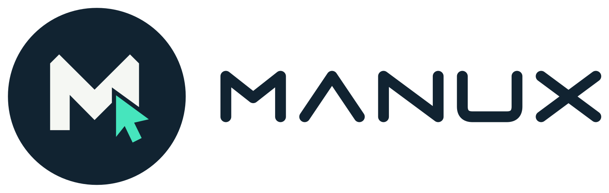
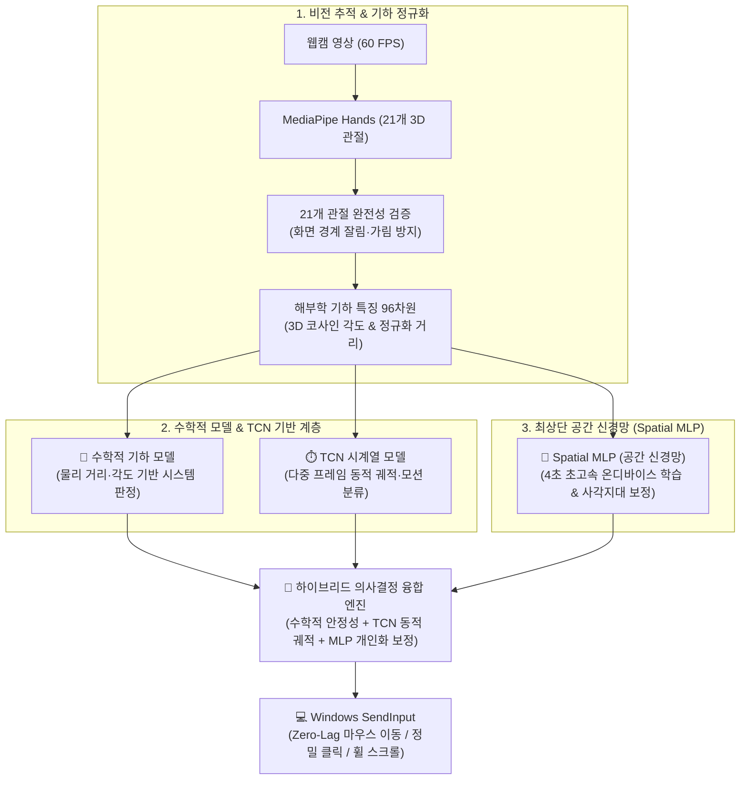

<div align="center">

  

  # 🖐️ MANUX: Next-Gen AI Vision Air Mouse

  **일반 웹캠과 온디바이스 MediaPipe 3D 비전 + 자체 제작 96차원 공간 신경망(Spatial MLP)으로 Windows를 손으로 제어하는 차세대 핸즈프리 에어 마우스 시스템**

  <p align="center">
    
    
    
    
    
    
  </p>
  <p align="center">
    
    
    
    
    
    
  </p>

</div>

---

## ⚡ 빠른 실행 (1-Click Run)

루트 폴더의 **`run_manux.bat`**를 더블클릭하면 패키지 동기화와 데스크톱 앱 실행이 자동으로 진행됩니다.

```batch
run_manux.bat
```

> **시스템 요구사항**: Windows 10/11 (x64), Python 3.12 (`uv`), 일반 USB 웹캠 또는 노트북 내장 카메라

### 수동 실행 (CLI)
```powershell
cd apps/manux
uv run --extra ui --extra vision --extra ml python -m manux
```

---

## 🤖 자체 제작 온디바이스 AI 모델: 수학 모델 + TCN 위에 얹는 Spatial MLP

MANUX는 단순 거리 임계값 기반 규칙 판정의 한계(카메라 화각 편차, 손목 회전, 손 크기 차이 등)를 근본적으로 극복하기 위해 **기초 3D 수학적 기하 규칙 모델과 시계열 동적 모션을 감지하는 TCN 모델 위에, 개인 맞춤형 초경량 공간 신경망(Spatial MLP)을 얹은 3단계 계층형 하이브리드 지능 아키텍처**를 탑재했습니다.



### 1. 수학적 모델 + TCN 모델 위에 얹는 3단계 계층 구조
* **1계층 - 수학적 기하 모델 (Mathematical Geometric Rule Engine)**:  
  손가락 관절 간의 유클리드 거리, 3D 기저 벡터 각도 등 엄밀한 기하학적 수식으로 동작하며, 어떤 환경에서도 무너지지 않는 가장 튼튼한 시스템 기본 판정의 뼈대 역할을 담당합니다.
* **2계층 - 시계열 TCN 모델 (Temporal Convolutional Network)**:  
  과거 연속 프레임의 시계열 버퍼링을 기반으로 스와이프, 던지기(Fling), 동적 제스처 등 시간 축에 걸쳐 일어나는 궤적 패턴을 전문적으로 판별합니다.
* **3계층 - 최상단 공간 신경망 Spatial MLP (Spatial Multi-Layer Perceptron)**:  
  수학 모델과 TCN 모델 위에서 **1프레임 단위의 즉각적인 공간 자세(96차원 해부학 기하 벡터)를 초저지연(0.003ms)으로 추론**합니다. 사용자 개인별 손가락 굵기, 관절 유연성, 카메라 각도에 따른 미세한 사각지대와 채터링을 단 4초 만에 학습하여 정밀하게 보정합니다.

### 2. 96차원 해부학 기하 특징 (Domain Feature Engineering)
> **💡 왜 단순 관절 좌표를 쓰지 않는가?**  
> MediaPipe가 제공하는 21개 관절의 단순 $(x, y, z)$ 좌표를 그대로 신경망에 입력하면, **카메라와의 거리, 손목의 회전 각도(Roll/Pitch/Yaw), 손 크기 편차**에 따라 수치가 제각각 변해 모델이 쉽게 오작동합니다.  
> 따라서 신경망에 들어가기 전, 회전 및 거리 불변성을 보장하는 **96차원의 정규화 기하 특징 벡터**를 추출하여 AI의 입력으로 사용합니다.

* **3D 손바닥 로컬 좌표계 정규화**:
  손목(0번)과 중지 중수골 관절(9번)을 잇는 축을 기준 삼아 손바닥 고유의 3차원 축을 유도합니다. 손목이 돌아가거나 카메라 거리가 바뀌어도 손바닥 기준 로컬 평면으로 좌표를 사전에 투영·정규화하므로 탁월한 회전/거리 불변성을 가집니다.
* **해부학적 기하 지표 산출**:
  5대 손가락 3D 관절 코사인 각도(`cos3D`), 지문 간 3D 클리어런스, 손가락 굽힘 비율 등 엄밀한 기하학적 계산치 96차원을 산출하여 신경망에 주입합니다.

### 3. 4초 초고속 온디바이스 학습 & 인풋 랙 0초 (Zero-Lag)
* **TCN과 Spatial MLP의 상호 보완**:  
  시계열 버퍼링이 필요한 TCN의 동적 모션 판정과, 지연 시간 0초(Zero-Lag, 0.003ms)로 즉각 반응하는 Spatial MLP의 공간 클릭 판정을 유기적으로 융합하여 쾌적한 조작감을 제공합니다.
* **4초 즉시 학습 (Instant 4s On-Device Training)**:
  LeakyReLU 활성화 함수와 Adam 옵티마이저를 기반으로 수집된 사용자 데이터를 단 4초 만에 학습 완료하고, 앱 재시작 없이 메모리에 즉시 핫로드합니다.
* **21개 관절 완전 인식 보장 필터링**:
  손이 화면 경계에 걸려 관절이 잘리거나 가려졌을 때 불완전한 표본이 학습 데이터셋에 혼입되는 것을 원천 차단하여 모델 신뢰도를 극대화합니다.

---

## 🎛️ Pose Snapshot Studio & Spatial MLP 모델 매니저

앱 내 상단/사이드바의 **[Pose Studio (MLP)]**를 통해 내 손 모양에 최적화된 맞춤형 모델을 직접 수집하고 학습시킬 수 있습니다.

```
┌─────────────────────────────────────────────────────────────────────────────┐
│ 🖐️ MANUX Pose Studio (Spatial MLP)                                         │
├────────────────────────────────┬────────────────────────────────────────────┤
│ 📌 정답 제스처 선택 (1~8)      │ 🤖 모델 관리                               │
│ [1] 중립/이동 (none)           │  현재 모델: [ default_model.json   ▼ ]     │
│ [2] 좌클릭 (thumb_middle)      │  새 모델 추가: [ custom_fast    ] [생성]   │
│ [3] 우클릭 (thumb_ring)        │  [⚡ 즉시 학습 (4초)] [🗑️ 모델 삭제]        │
│ [4] 양쪽 클릭 (엄지+중지+약지) │                                            │
│ [5] 스크롤 UP  [6] 스크롤 DOWN │ 📊 데이터셋 현황 (현재 모델)               │
│ [7] 특수 검지  [8] 새끼 핀치   │  - 현재 세션: 12개                         │
│                                │  - 누적 저장: 350개 (새 모델 시 0개 분리)  │
├────────────────────────────────┴────────────────────────────────────────────┤
│ ⚙️ 수집 옵션: [x] 불일치(사각지대)만 수집   [x] 21개 관절 완전 인식 시만 수집│
│ 🎮 수집 토글: [ Space 키 ] 단일 캡처 / 50ms 연속 스트림 자동 수집           │
└─────────────────────────────────────────────────────────────────────────────┘
```

### 1. 실시간 표본 수집 (스냅샷 & 연속 스트림)
- **단일 스냅샷 / 50ms 연속 수집**: `Space` 키 하나로 정밀 1프레임 캡처 또는 50ms 간격 자동 스트림 수집을 제어할 수 있습니다.
- **불일치(사각지대) 자동 선별 모드**: 시스템 판정(규칙 엔진)과 내가 지정한 정답이 서로 다른 프레임만 자동으로 골라 수집하여, AI의 취약 각도를 집중 보강합니다.
- **21개 관절 완전 인식 필터**: 화면 경계 밖으로 손가락이 잘리거나 가려진 프레임은 자동으로 수집을 건너뜁니다.

### 2. 다중 모델 관리 및 모델별 누적 데이터셋 분리
- **새 모델 슬롯 즉시 생성**: 원하는 모델 이름을 입력하고 [생성]을 누르면 즉시 새로운 모델 슬롯이 등록됩니다.
- **모델별 누적 데이터셋 완전 격리**: 새 모델을 생성하거나 전환하면 **누적 0개**로 시작하며, 모델별로 독립된 스냅샷 파일(`manux_pose_snapshots_<모델명>_*.json`)로 저장되어 서로 데이터가 섞이지 않습니다.
- **실시간 무중단 핫스왑 (Hot-Swap)**: 학습 완료된 모델을 선택하면 앱을 재시작할 필요 없이 실시간 Windows 제어 파이프라인에 즉시 교체 적용됩니다.

---

## 🎮 제스처 조작 표 (Pinch & Spatial Action)

| 제스처 | 동작 명칭 | 기능 설명 | 세부 판정 기준 |
| :---: | :---: | :---: | :--- |
| **👆 검지 조준** | `none` (중립/이동) | **커서 이동** | 검지 끝을 추적하며, 1€ 필터로 미세 떨림을 제거한 정밀 조준 |
| **👌 엄지+중지 핀치** | `thumb_middle` | **좌클릭 & 연속 드래그** | 엄지와 중지를 맞닿으면 즉시 좌클릭, 유지 시 드래그 |
| **🤏 엄지+약지 핀치** | `thumb_ring` | **우클릭** | 엄지와 약지를 맞닿으면 즉시 우클릭 |
| **🫰 엄지+중지+약지 핀치** | `thumb_middle_ring` | **양쪽 동시 클릭** | 엄지, 중지, 약지를 동시에 모아 좌/우클릭 동시 실행 |
| **✌️ V자 (Peace) 모션** | `scroll_up` / `down` | **마우스 휠 스크롤** | V자 제스처 후 상하 이동으로 부드러운 스크롤 |
| **✊ 주먹 (Fist) / 손바닥** | `fist` / `idle` | **안전 휴식 (Safety Gate)** | 모든 마우스 조작을 즉시 중단하고 대기 |

---

## ⌨️ 단축키 안내 (Hotkeys)

| 단축키 | 적용 위치 | 기능 설명 |
| :--- | :--- | :--- |
| **`Space`** | Pose Studio | **표본 수집 토글** (단일 스냅샷 또는 연속 스트림 수집 시작/정지) |
| **`Backspace`** | Pose Studio | **직전 표본 즉시 삭제 (Undo)** |
| **`1` ~ `8`** | Pose Studio | **정답 제스처 클래스 즉시 선택** (1: 이동, 2: 좌클릭, 3: 우클릭, 4: 양쪽클릭 등) |
| **`Tab`** | Pose Studio | **정답 제스처 순환 변경** (`none` ➔ `thumb_middle` ➔ `thumb_ring` ...) |
| **텍스트 입력 보호** | Pose Studio | 모델 이름 입력창에 포커스가 있을 때 단축키가 비활성화되어 안전하게 타이핑 가능 |

---

## 📂 프로젝트 폴더 구조 및 아키텍처

엄격한 계층 구조(`tests/architecture/test_layers.py`)를 통해 모듈 간 단방향 의존성을 100% 보장합니다:
`core` ➔ `capture` ➔ `data` ➔ `perception` ➔ `features` ➔ `ml` ➔ `actions` ➔ `ui`

```text
manux-preview/
├── 📄 run_manux.bat                 # 🔥 원클릭 환경 구성 및 앱 실행기
├── 📄 README.md                     # 프로젝트 종합 안내 문서
│
└── 📁 apps/manux/                   # Python + Qt/QML 메인 애플리케이션
    ├── 📄 pyproject.toml            # uv 패키지 명세 및 의존성 정의
    │
    ├── 📁 src/manux/                # [핵심] 계층형 클린 아키텍처
    │   ├── 📁 core/                 # 도메인 모델, 공통 타입 및 인터페이스
    │   ├── 📁 capture/              # 웹캠 영상 캡처 (OpenCV) & 비디오 루프
    │   ├── 📁 perception/           # MediaPipe 21개 3D 관절 랜드마크 추출
    │   ├── 📁 features/             # 96차원 해부학 공간 기하 특징(Spatial Features) 추출
    │   ├── 📁 ml/                   # Spatial MLP 신경망 모델, 4초 트레이너, TCN 확인기
    │   ├── 📁 data/                 # ⭐ [Pose Studio] 표본 수집, 다중 모델 매니저, 데이터셋 관리
    │   ├── 📁 actions/              # Windows SendInput 네이티브 마우스 제어 & 1€ 필터
    │   └── 📁 ui/                   # PySide6 Qt/QML 대시보드 및 C++/Python 브리지
    │       ├── 📄 bridge.py         # QML ↔ Python 실시간 고속 양방향 데이터 바인딩
    │       └── 📁 qml/              # 하이테크 네온 다크 대시보드 UI (`dashboard.qml`)
    │
    └── 📁 tests/                    # 자동화 테스트 스위트 (111개 테스트 100% 통과)
        ├── 📁 unit/                 # 단위 테스트 (데이터, UI, 캡처, ML 모델 검증)
        ├── 📁 integration/          # 파이프라인 통합 및 핫스왑 검증
        └── 📁 architecture/         # 계층 간 의존성 규칙 정적 검사 (`test_layers.py`)
```

---

## 🧪 테스트 및 품질 검증

MANUX는 철저한 테스트 주도 개발(TDD)을 바탕으로 작성되었으며, 모든 단위/통합/아키텍처 테스트를 통과합니다.

```powershell
cd apps/manux
uv run pytest -q
```

```text
........................................................................ [ 64%]
.......................................                                  [100%]
111 passed in 7.00s
```

---

## 🔒 개인정보 및 안전 원칙

* **100% 로컬 온디바이스 처리**: 웹캠 영상과 손 관절 좌표는 외부 서버로 일절 전송되지 않으며, 사용자 로컬 PC 메모리 내에서만 실시간 처리 후 소멸됩니다.
* **비상 안전 게이트**: 손바닥을 펴거나 주먹을 쥐면 모든 마우스 조작이 즉시 무효화되어 의도치 않은 클릭이나 창 닫힘을 방지합니다.
* **격리된 독립 데이터셋**: 수집된 제스처 데이터는 사용자 로컬 폴더에 모델별로 분리 저장되어 언제든 자유롭게 수정 및 삭제가 가능합니다.
