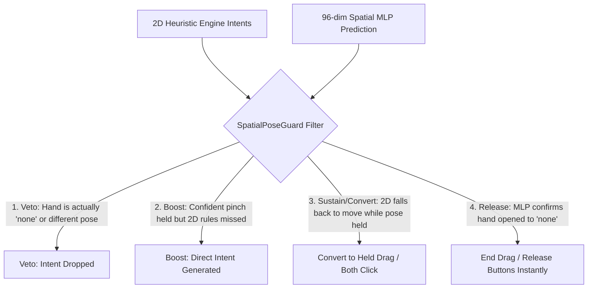

# MANUX (v0.5)

<p align="center">
  
  
  
  
  
  
  
  
</p>

웹캠을 통해 Windows 마우스와 제스처를 손짓만으로 정밀하게 제어하는 AI 휴먼 인터페이스 앱입니다.  
단일 프로세스 내에서 **PySide6(Qt/QML)** UI, **Google MediaPipe** 3D 손 랜드마크 추적, 그리고 초경량 **96차원 Spatial MLP(3D 공간 신경망)** 모델이 센서 퓨전(Sensor Fusion)되어 극저지연(3.0µs)의 안정적인 제스처 마우스 경험을 제공합니다.

---

## ⚡ v0.5 핵심 기능 & 최신 개선 사항 (Key Features)

### 1. 물리 마우스 1:1 조작 패러다임 (Pure 1:1 Physical Mouse Emulation)
- **인위적 딜레이/버퍼링 완전 폐기**: 지연 보류(`pending click`) 로직을 걷어내고, 실제 하드웨어 마우스와 정확히 동일한 1:1 즉각 반응 구조로 전환했습니다.
- **자세 접촉/유지 (Contact & Hold)**: 손가락이 닿거나 제스처를 취하는 순간 즉시 마우스 버튼 Down (`buttons.press`).
- **자세 유지 중 이동 (Drag)**: 버튼이 눌린 상태 그대로 커서가 이동하여 좌클릭 드래그 및 우클릭 드래그가 자연스럽게 동작.
- **자세 해제 (Release on Separate)**: 손가락을 떼는 순간 즉시 마우스 버튼 Up (`buttons.release` on `mouse.move`).
- **지뢰찾기, 웹 서핑, 창 드래그 완벽 지원**: 불필요한 더블클릭 오발화나 버튼 릴리즈 딜레이 없이 마우스와 똑같이 반응합니다.

### 2. 우클릭 드래그 & 양쪽 동시 클릭 (`thumb_middle_ring`)
- **우클릭 드래그 (`pinch.right_drag`)**: 엄지+약지(`thumb_ring`)를 맞댄 채 손을 움직이면 우클릭이 눌린 채 자유롭게 드래그됩니다.
- **양쪽 동시 클릭 (Chording)**: 엄지+중지+약지를 동시에 맞대면 마우스 좌클릭과 우클릭이 동시에 눌린 상태로 유지됩니다. 지뢰찾기(Minesweeper)에서 주변 숫자 타일 동시 열기, CAD 및 3D 모델링 툴의 뷰포트 양쪽 버튼 조작을 손짓만으로 수행할 수 있습니다.

### 3. 학습 센터 (포즈 스튜디오 / PoseSnapshotStudio) 고도화
- **"누르고 있는 중인 자세(Continuous Hold)" 실시간 수집**: 모델 학습에 사용하는 데이터는 클릭 순간의 찰나가 아닌 '누르고 있는 중인 자세'입니다. 우클릭(`thumb_ring`)이나 양쪽 클릭(`thumb_middle_ring`)을 취했을 때 2D 규칙 간섭으로 좌클릭으로 오분류되던 현상을 완전히 해결했습니다.
- **21개 전 관절 인식 검증 (`require_full_joints`)**: 화면 테두리 밖으로 손가락이 잘려 불완전한 상태로 수집되는 왜곡 표본을 원천 차단합니다.
- **4초 즉시 학습 & 무중단 핫리로드 (Zero-Restart)**: 앱 재부팅 없이 수집한 표본을 4초 만에 즉시 학습하여 실시간 엔진에 바로 적용합니다.
- **멀티 모델 관리**: 작업 용도별(고속 작업용, 정밀 작업용 등) 모델을 생성·전환·삭제할 수 있습니다.

### 4. 3D Spatial MLP & Sensor Fusion 레이어 (`SpatialPoseGuard`)
- **2D 한계 극복**: 카메라 각도 왜곡과 원근감에 취약했던 기존 2D 유클리드 좌표 판정에서 벗어나, 3D 월드 랜드마크 기반 **96차원 공간 기하학 특징(Spatial Features)** 추출.
- **초경량 Zero-GC 인퍼런스**: 순수 NumPy 행렬 연산으로 **0.003ms (3.0µs)** 추론 속도를 달성하여 프레임 드랍 없는 실시간 보정 수행.
- **센서 퓨전 & 오판 교정**: 손이 기울어지거나 가로로 누워도 MLP가 자세를 확인하면 2D 규칙의 오판을 실시간으로 올바른 제스처로 변환/보호합니다.

### 5. 모션 모드와 기본 마우스 조작의 완전 분리 (Decoupled Motion Mode)
- 엄지척(`thumbs_up`)으로 모션 모드를 켜도 기존 마우스 이동, 클릭, 스크롤 등의 기본 동작이 멈추지 않고 그대로 동작하며, 모션 제스처만 추가 레이어로 함께 작동합니다.

### 6. 바탕화면 보기(`palm_side`) 수평 손 검증 & 고급 설정
- 일상적인 손 이동 중 바탕화면이 열리는 오발화를 방지하기 위해, 손바닥을 가로로 눕힌 수평 손자세($dx \ge 0.65 dy$)와 일정 시간 유지를 엄격히 검증합니다.
- 설정 UI에서 바탕화면 보기 기능을 켜고 끌 수 있는 토글(`enable_thumb_tucked_open`)을 제공합니다.

### 7. 로컬 Git 리포지토리 영구 연동 (Persistent Local Dataset & Model Management)
- **숨은 AppData 종속 탈피**: 기존에는 스튜디오에서 수집한 스냅샷 및 훈련된 모델이 Windows `%APPDATA%` 폴더로 저장되어 Git 버전 관리에 반영되지 못하는 문제가 있었습니다.
- **로컬 디렉터리 자동 바인딩**: 개발 환경(`not frozen`)에서 스냅샷 수집 및 백그라운드 학습 시, 리포지토리 내의 `data/pose_snapshots/` 및 `models/spatial_mlp/`에 즉시 기록되도록 근본적인 경로 해석(`pose_snapshots_dir`, `spatial_models_dir`)을 개편했습니다.
- **22,893개 골드 데이터셋 Git 완전 추적**: 우클릭(`thumb_ring`), 양쪽 동시클릭(`thumb_middle_ring`), 좌클릭(`thumb_middle`), 스크롤(`thumb_index`), 가드(`none`) 등 10개 클래스의 37개 JSON 데이터셋(22,893개 표본)과 최신 `gh.json` 모델이 브랜치에 안전하게 영구 보존됩니다.

---

## ✋ 지원 제스처 및 동작 목록 (10 Gestures)

| 번호 | 클래스 ID | 제스처 이름 | 매핑 동작 | 조작 설명 |
|:---:|---|---|---|---|
| **0** | `none` | 이동 / 대기 | 커서 이동 (`mouse.move`) | 손을 편 채 또는 주먹을 쥐고 자유롭게 커서 이동 |
| **1** | `thumb_middle` | 좌클릭 / 좌클릭 드래그 | 좌클릭 및 드래그 (`mouse.left_click`, `mouse.drag`) | 엄지와 중지를 맞대어 클릭, 맞댄 채 움직이면 드래그 |
| **2** | `thumb_ring` | 우클릭 / 우클릭 드래그 | 우클릭 및 드래그 (`mouse.right_click`, `pinch.right_drag`) | 엄지와 약지를 맞대어 우클릭, 맞댄 채 움직이면 우클릭 드래그 |
| **3** | `thumb_middle_ring` | 양쪽 동시 클릭 | 좌우 버튼 동시 누름 유지 (`mouse.both_click`) | 엄지+중지+약지 3점을 맞대어 양쪽 버튼 동시 홀드 (지뢰찾기 등) |
| **4** | `thumb_index` | 스크롤 | 부드러운 스크롤 (`mouse.scroll`) | 엄지와 검지를 맞댄 채 손을 상하좌우로 움직여 스크롤 |
| **5** | `thumb_pinky` | 작업 전환기 | 윈도우 작업 전환 창 열기 (`window.task_switcher`) | 엄지와 새끼손가락을 맞대기 (Ctrl+Alt+Tab) |
| **6** | `palm_side` | 바탕화면 보기 | 모든 창 최소화 / 복원 (`window.show_desktop`) | 손바닥을 수평으로 눕히고 엄지를 접어 0.6초 유지 (Win+D) |
| **7** | `thumbs_up` | 모션 모드 | 모션 모드 전환 (`motion.enter` / `motion.exit`) | 주먹을 쥐고 엄지만 위로 세워 모션 제어 모드 토글 |
| **8** | `v_sign` | 제어 일시정지 | 마우스 조작 일시정지 / 재개 (`control.v_sign`) | 검지와 중지를 펴서 V자 모양을 1.5초간 유지 |
| **9** | `rock_sign` | 창 닫기 | 현재 활성 창 닫기 (`window.close`) | 검지와 새끼손가락을 세운 락 사인 (Alt+F4) |

---

## 🧠 [AI 병합 및 유지보수 가이드] 아키텍처 설계 & 수정 이유 (AI Merge Reference)

> [!IMPORTANT]
> **향후 다른 AI 에이전트 또는 개발자가 본 브랜치(`v0.5-testing-mlp`)의 변경 사항을 메인 브랜치나 타 브랜치로 병합(Merge)할 때 반드시 숙지해야 하는 아키텍처 설계 배경과 핵심 규칙입니다.**  
> 과거의 인위적 버퍼링이나 2D 하드코딩 덮어쓰기 방식으로 롤백하지 마십시오.

### 1. 왜 기존 로직을 수정했는가? (Problem & Rationale)

1. **클릭 보류/버퍼링(`_pending_click`) 폐기 및 물리 마우스 1:1 에뮬레이션 전환**
   - **기존 문제**: 손가락이 닿았을 때 즉시 누르지 않고 대기했다가 손을 뗄 때 클릭을 발생시키는 방식은, 사용자가 마우스 클릭감을 직관적으로 느낄 수 없었으며, 뗄 때 더블클릭이 연타되거나 지뢰찾기에서 타일이 의도치 않게 눌리는 버그를 유발했습니다.
   - **수정 이유**: 마우스는 **'누를 때 Down, 뗄 때 Up'** 이 절대적인 기본 원칙입니다.
     - 손가락 닿음 / 자세 취함 $\rightarrow$ 즉시 `buttons.press` (누름 유지).
     - 자세 유지 채 이동 $\rightarrow$ 누른 상태 유지하며 `drag` 수행.
     - 손가락 뗌 $\rightarrow$ `mouse.move` 수신 즉시 `buttons.release` (누름 해제).
     - 더블클릭 튐 문제는 OS 싱크의 접촉 디바운스(200ms) 및 위치 고정 윈도우(`double_click_window`)로만 해결했습니다.

2. **2D 유클리드 좌표의 한계 극복 및 3D Spatial MLP의 절대적 필요성**
   - **기존 문제**: 기존 2D 규칙 엔진(`PinchCore`)은 카메라 2D 평면에 투영된 $(x, y)$ 유클리드 거리만 측정했습니다.
     - 손을 비스듬히 기울이거나 가로로 눕히면, 실제로는 약지(`thumb_ring`)를 맞댔음에도 2D 투영상 중지-엄지 거리가 더 가까워져 **우클릭이 좌클릭으로 오판**되었습니다.
     - 또한 2D 규칙은 한 번에 한 핀치만 허용하는 상호 배타 락(`side_pinch_exclusive`)이 걸려 있어, **양쪽 동시 클릭(`thumb_middle_ring`)이 구조적으로 불가능**했습니다.
   - **수정 이유**: 3D 월드 랜드마크 기반 **96차원 Spatial MLP**를 센서 퓨전 레이어(`SpatialPoseGuard`)로 배치했습니다.
     - 손목 중심 평행이동 불변(Translation invariant) 및 손 크기 불변(Scale invariant) 정규화를 적용하여, 손이 어떤 각도와 거리에 있든 99% 정확도로 10개 제스처를 실시간 판정합니다.

3. **학습 센터(PoseSnapshotStudio)의 2D 간섭 버그 척결**
   - **기존 문제**: 학습 센터에서 우클릭(`thumb_ring`)이나 양쪽 클릭(`thumb_middle_ring`) 자세를 취해도 화면과 모델 판정 박스에 `"좌클릭 (엄지+중지)"`로만 표시되었습니다.
     - 원인 1: `GESTURE_TO_STUDIO_CLASS`에 `"pinch.right_drag": "thumb_ring"` 매핑이 누락되어 `mouse.drag` $\rightarrow$ `thumb_middle`로 강제 변환됨.
     - 원인 2: `_compute_hybrid_action()`에서 2D 규칙(`sys_act`)이 핀치 상태면 **MLP 모델의 실제 예측값(`live_ai_action`)을 무시하고 `sys_act`로 덮어쓰는 하드코딩**이 존재했음.
   - **수정 이유**: 2D 덮어쓰기 로직을 전면 제거하여, 모델이 학습된 상태에서는 순수하게 Spatial MLP의 예측값을 표시하도록 일원화했습니다.

4. **"클릭 학습 데이터 = 누르고 있는 중인 자세 (Continuous Hold)" 정의**
   - **수정 이유**: 사용자가 학습 센터에서 수집하는 데이터는 '찰나의 클릭 순간'이 아니라 **'버튼을 누르고 있는 동안 취하는 손 모양'** 입니다.
   - 따라서 MLP가 해당 클래스를 확신하는 동안은 버튼이 계속 눌려있는 상태(Hold/Drag)로 간주하며, 손이 펴질 때(`none`) 비로소 해제되도록 엔진 전반의 생명주기를 통일했습니다.

5. **학습 표본 및 MLP 모델의 로컬 리포지토리 영구 바인딩 (Path Resolution)**
   - **기존 문제**: 기존 `AppPaths`는 개발 모드(`not frozen`)에서도 모든 사용자 데이터를 `%APPDATA%/MANUX-dev/v04`에 기록하도록 설계되었습니다. 그 결과, 포즈 스튜디오에서 수집한 스냅샷 JSON 파일들과 새로 학습된 `gh.json` 모델이 로컬 Git 작업 트리가 아닌 Windows의 숨겨진 AppData 폴더에 격리 저장되어 Git 버전 관리에 반영되지 못했습니다.
   - **수정 이유**: `AppPaths`에 `pose_snapshots_dir`와 `spatial_models_dir` 프로퍼티를 추가하여, 개발 모드에서는 항상 로컬 리포지토리의 `data/pose_snapshots` 및 `models/spatial_mlp`를 직접 가리키도록 파이프라인 전체(`desktop.py`, `pose_studio.py`, `app_worker.py`, `studio_worker.py`)를 재구성했습니다. (단, 배포 패키지 `frozen=True`나 `MANUX_DATA_DIR` 환경변수 지정 시에는 격리된 사용자 데이터 경로를 유지하여 권한 충돌을 방지합니다.)
   - **병합 시 주의**: 병합 시 `desktop.py`의 `make_pose_studio`, `TrainingCenterService`, `app_worker.py`에 전달되는 `snapshots_dir` 및 `models_dir` 매개변수를 삭제하거나 임의로 단순 `data_dir`로 되돌리지 마십시오.

---

### 2. Spatial MLP & Guard 센서 퓨전 동작 원리 (Internal Mechanism)

`src/manux/features/spatial_pose/__init__.py`의 `SpatialPoseGuard`는 2D 규칙 엔진의 출력을 가로채 아래 4가지 경로로 필터링합니다:



1. **Veto (오발화 차단)**:
   - 2D 거리가 일시적으로 좁혀져 클릭을 발생시키려 해도, MLP가 $k$프레임 이상 `none`(열린 손/단순 이동)으로 판정하면 클릭을 즉시 차단합니다.
   - 가로 손 자세가 아닌 일상 손 움직임 중 발생하는 2D 바탕화면 보기(`pinch.thumb_tucked_open`)를 원천 차단합니다.
2. **Boost (능동 보강 발화)**:
   - 2D 규칙이 카메라 각도 왜곡으로 핀치 거리를 놓치더라도, MLP가 핀치 자세(`thumb_middle`, `thumb_ring`, `thumb_middle_ring`)를 안정적으로 판정하면 가드에서 직접 클릭 이벤트를 생성합니다.
3. **Conversion & Sustain (누름 유지 및 드래그 보호)**:
   - 자세를 유지한 채 손을 움직일 때 2D 규칙이 드래그 대신 일반 이동(`pinch.move`)을 보내더라도, MLP가 여전히 `thumb_middle`, `thumb_ring`, `thumb_middle_ring`을 인식하고 있다면 이를 즉시 `pinch.drag`, `pinch.right_drag`, 양쪽 클릭 홀드로 변환하여 **마우스 버튼이 중간에 떼어지지 않도록 보호**합니다.
   - 반대로 사용자가 손을 펴서 `none`이 되면 2D 릴리즈 지연을 기다리지 않고 즉시 드래그를 종료(`end`)합니다.

---

### 3. 수정된 핵심 파일 및 역할 (Code Map for Merging)

| 파일 경로 | 수정 내용 및 주의사항 (병합 시 확인) |
|---|---|
| `src/manux/output/windows/sink.py` | • **1:1 물리 마우스 에뮬레이션**: `buttons.press` on contact, `buttons.release` on `mouse.move`.<br>• `_holding_left`, `_holding_right` 독립 관리 (양쪽 클릭 동시 누름 충돌 방지).<br>• 우클릭 드래그(`_do_mouse_drag` button="right") 및 멱등적 홀드 지원. |
| `src/manux/features/spatial_pose/__init__.py` | • `SpatialPoseGuard` 센서 퓨전 로직.<br>• `left_pose_active`, `right_pose_active`, `both_pose_active` 삼원화.<br>• 2D가 좌드래그로 오판한 이벤트를 MLP 확인 시 `pinch.right_drag`로 실시간 전환.<br>• 자세 유지 중 `pinch.move` 유입 시 드래그/양쪽 클릭 유지로 변환. |
| `src/manux/data/pose_studio.py` | • `GESTURE_TO_STUDIO_CLASS`에 `"pinch.right_drag": "thumb_ring"` 등록.<br>• `normalize_system_action`: 좌+우 동시 활성 시 `thumb_middle_ring` 반환.<br>• `_compute_hybrid_action`: 2D 하드코딩 덮어쓰기 제거하고 순수 MLP 예측값 보존.<br>• `is_full_joints_tracked`: 21개 관절 화면 잘림 필터. |
| `src/manux/features/pinch/engine.py` | • `nearest == "ring"` 진입 시 중지(`middle`) 락아웃 조기 해제.<br>• `PinchFrame`에 `action="right_drag_hold"` 추가 및 링 드래그 앵커 지원. |
| `src/manux/features/pinch/preview.py` | • `ACTION_FINGER`에 `"right_drag_hold": "ring"` 추가하여 카메라 오버레이 연동. |
| `src/manux/ui/bridge.py` | • 스튜디오 화면 진입 시 실시간 핀치 가이드 및 관절 거리로 우클릭·양쪽클릭 실시간 판정.<br>• 모션 모드 켜짐 시에도 기본 마우스 제어가 살아있도록 분리. |
| `src/manux/settings/paths.py` | • `AppPaths.pose_snapshots_dir` 및 `spatial_models_dir` 추가.<br>• 개발 모드(`not frozen`)에서 로컬 리포지토리의 `data/pose_snapshots` 및 `models/spatial_mlp` 자동 바인딩.<br>• 배포 패키지(`frozen=True`) 및 `MANUX_DATA_DIR` 오버라이드 격리 완벽 보장. |
| `tools/app_worker.py` & `tools/studio_worker.py` | • UI 학습 및 스튜디오 비동기 작업 시 `snapshots_dir`, `models_dir` 파라미터 수신 및 로컬 디렉터리 연동.<br>• 백그라운드 프로세스에서도 로컬 브랜치 경로 직접 접근 및 원자적(atomic) 모델 저장. |
| `tools/train_spatial_mlp.py` | • 로컬 `data/pose_snapshots`의 22,893개 표본 기준 1.8초 초고속 재학습 CLI (`--model gh.json`). |

---

## 🚀 빠른 시작 (Quickstart)

### 1. 데스크톱 앱 실행
```powershell
uv run --locked --python 3.12 --extra ui --extra vision --extra ml python -m manux
```
- **화면 및 웹캠 확인**: MediaPipe Hand Landmarker와 Qt/QML 대시보드가 구동됩니다.
- **웹캠 없이 녹화 파일 재생**:
  ```powershell
  uv run --python 3.12 --extra ui python -m manux --replay <녹화.jsonl.gz> --no-windows-input
  ```
- **자가 진단 (Self Check)**:
  ```powershell
  python -m manux --self-check out.json
  ```

### 2. Spatial MLP 모델 원클릭 학습 (1.8초)
내장된 22,893개 골드 스냅샷 샘플(37개 JSON 데이터셋 파일)을 기반으로 96차원 Spatial MLP를 즉시 재학습합니다:
```powershell
uv run --python 3.12 python tools/train_spatial_mlp.py
```
기본값은 `models/spatial_mlp/gh.json`에 학습 결과가 저장되며(`--model <이름>`으로 변경 가능), `models/spatial_mlp/active_model.json`의 `active_model_id`가 가리키는 모델이 앱 실행 시 로드됩니다.

### 3. 단위 테스트 실행 (895개 전체 검증)
```powershell
uv run --locked --python 3.12 pytest -q
```
*클릭 1:1 에뮬레이션, 드래그 유지, 우클릭 드래그, 양쪽 클릭, Spatial Guard, 스튜디오 전 기능 895개 테스트가 100% 통과하도록 검증됩니다.*

---

## 📁 주요 문서 링크

1. [AGENTS.md](AGENTS.md): 작업 규칙과 기능 추가 절차
2. [docs/architecture.md](docs/architecture.md): 폴더 구조, 프레임 파이프라인, 모듈 의존성
3. [docs/contracts.md](docs/contracts.md): Intent, Observation, Output Sink 간 인터페이스 계약
4. [docs/advanced-settings.md](docs/advanced-settings.md): 감도 및 고급 설정 제어
5. [docs/eval-judges.md](docs/eval-judges.md): 규칙 vs MLP vs TCN 판정기 벤치마크
6. [docs/dataset-hub.md](docs/dataset-hub.md): 제스처 데이터 수집 및 허브 동기화 가이드

---

## 🛠️ 패키징 및 빌드

```powershell
# 기본 프리뷰 로컬 빌드
./packaging/build.ps1 -Version 0.5.0-local

# 고급 학습 컴포넌트 포함 빌드
./packaging/build.ps1 -Version 0.5.0-local -WithTrainer

# 릴리즈 채널 빌드
./packaging/build.ps1 -Version 0.5.0 -Release
```
정식 릴리즈는 `manux-production` 브랜치 push 시 GitHub Actions 워크플로우를 통해 자동으로 배포됩니다.
