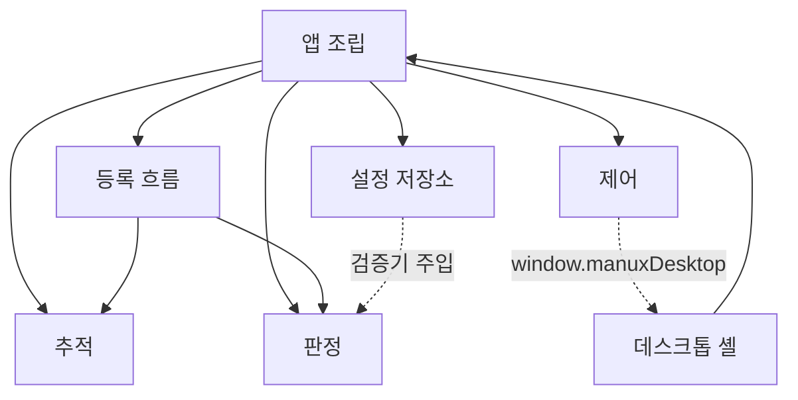

# 02. 컴포넌트 설계서 (M1)

> 상태: **AI 초안, 사람 검수 전** (2026-11-03). 입력: [01 유스케이스](01-use-cases.md)와 실제 `src/`·`desktop/` 코드(2026-11-03 `preview`, 열린 PR #12·#13 포함).
>
> **하지 않는 것** 열이 이 문서의 핵심이다. 사람·에이전트가 병렬로 일할 때 이 경계가 파일 분할선이다. 경계를 넘는 변경은 소비 컴포넌트 담당과 먼저 계약([03 인터페이스](03-interfaces.md))을 맞춘다.

컴포넌트는 7개다. 강의 기준(4±1)보다 많은데, 데스크톱 OS 입력과 저장소를 분리해 두어야 각 실패 경로를 따로 시험할 수 있기 때문이다. 묶음을 줄일지는 검수 때 정한다.

## 컴포넌트 표

| 컴포넌트 | 파일 | Jira 영역 | 책임 | 하지 않는 것 | 의존하는 것 |
| --- | --- | --- | --- | --- | --- |
| **추적** (Tracking) | `src/camera.js`, `src/vision-client.js`, `src/vision-worker.js`, `src/orientation.js` | V (SCRUM-6) | 카메라 제약 결정, 프레임 한 장씩 MediaPipe 추론, 관절·handedness·추론 시간 반환, 시간 초과 시 세션 전체 종료, 손 방향(yaw/pitch) 계산 | 손 모양이 *무엇인지* 판정(→판정), 명령 결정(→제어), 저장(→설정 저장소), 화면 문구 | MediaPipe Tasks(Worker 안) |
| **판정** (Recognition) | `src/personalization.js` | G (SCRUM-8) | 관절 → 특징 벡터·품질, 동작 하나의 후보 학습, 등록 레코드 추가·교체·삭제(새 레코드 반환), 등록 동작 대상 개방 집합 판정, 등록 레코드 검증기 | 표본 수집 순서·타이머(→등록 흐름), 저장 쓰기(→설정 저장소), 액션 선택·실행(→제어), 카메라 | 없음 (순수 함수) |
| **등록 흐름** (Enrollment) | `src/enrollment.js`, `src/enrollment-view.js` | G·U (SCRUM-8·9) | 한 세션의 단계(준비→정면 기준→각도 수집→확인), 새 관찰만 표본으로 채택, 각도 실패 시 그 각도만 재시도, `commandsSuppressed` 판단 | 후보 학습(→판정), 저장(→설정 저장소), 명령 *차단 실행*(판단만 하고 실제 차단은 →앱 조립), 저장된 등록 보유 | 판정(`POSES`, `FEATURE_COUNT`, `validGestureId`), 추적(`orientation`) |
| **제어** (Control) | `src/air-mouse-controller.js`, `src/index-pointer-controller.js`, `src/pointer-engine.js`, `src/overlay-frame.js`, `src/mouse-workspace.js`, `src/gesture-controller.js`, `src/media-controller.js` | C (SCRUM-7) | 관절 → 마우스 이벤트(`move`/`button`/`scroll`/`release`), 클릭 유지·핀치 겹침 보류, 정지·지연 감시와 해제, 연습 영역 적용; 영상 모드의 유지·잠금·반복과 영상 명령 | OS 호출(→데스크톱 셸), 손 모양 학습·등록(→판정), 설정 저장(콜백으로 →앱 조립), 등록 중 여부 판단(→등록 흐름) | 데스크톱 셸(`window.manuxDesktop`, 있을 때만) |
| **설정 저장소** (Settings) | `src/settings-store.js`, `src/profile-store.js` | A2 (SCRUM-10) | 버전 있는 설정 레코드의 트랜잭션 저장(복사→검사→쓰기→재확인→메모리 반영), 손상·새 버전·다른 창 저장 처리, 영상 모드 프로필 v1 읽기·쓰기 | 등록 레코드 *내용* 판단(판정의 검증기를 주입받음), 액션 이름 해석·실행(→제어), 화면 문구 | 없음 (`settings-store.js`). `profile-store.js`는 판정의 `validateProfile` |
| **데스크톱 셸** (Desktop) | `desktop/main.mjs`, `desktop/preload.cjs`, `desktop/mouse-bridge.mjs`, `desktop/overlay.mjs`, `desktop/overlay-protocol.mjs`, `desktop/overlay-preload.cjs`, `public/overlay.html`, `src/overlay-view.js`, `desktop/windows-mouse.ps1`, `desktop/security.mjs`, `desktop/updater.mjs` | A1 (SCRUM-10) | 신뢰된 renderer에서만 IPC 수신, 마우스 이벤트 재검증(형식·크기·나이), 입력 lease와 watchdog, Windows helper(SendInput) 생명주기, 전역 중지 단축키, 업데이트 다운로드·적용 | 손 판정·이벤트 *생성*(→제어), 임의 코드·셸·키보드 입력 노출, 설정 저장 | Electron, Windows PowerShell, 앱 서버(`server.js`) |
| **앱 조립** (App shell) | `src/app.js`, `public/index.html`, `public/styles.css`, `server.js` | A3·U (SCRUM-10·9) | 모듈 생성·연결, 프레임 루프(동시에 한 프레임), 모드 전환과 그때의 초기화, 등록 중 명령 차단 *실행*, 판정 결과를 제어로 전달, 화면 상태·문구, 정적 파일·LAN HTTPS 제공 | 판정 규칙·학습(→판정), 마우스 이벤트 규칙(→제어), 저장 트랜잭션 세부(→설정 저장소), OS 입력(→데스크톱 셸) | 나머지 다섯 renderer 컴포넌트 |

## 의존 방향

- 순환 없음. 앱 조립이 위에서 나머지를 부르고, 아래 컴포넌트끼리는 등록 흐름 → 판정·추적만 직접 import한다.
- `Desktop --> App`은 import가 아니라 데스크톱 셸이 `server.js`를 띄워 renderer 페이지를 여는 관계다.
- 설정 저장소는 판정을 import하지 않는다. 앱 조립이 `validateRegistrations`를 생성자에 넣는다. 그래서 저장소는 등록 레코드 형식이 바뀌어도 고칠 필요가 없다.
- 제어는 데스크톱 셸을 import하지 않는다. preload가 노출한 좁은 객체만 쓰며, 없으면 연습 영역만 쓴다.

## 공유 규칙 (어느 컴포넌트에도 속하지 않는 계약)

- **동시에 한 프레임:** 추적은 처리 중이면 새 프레임을 받지 않는다(`busy`). 앱 조립은 결과가 늦게 와도 세션 토큰이 바뀌었으면 버린다.
- **안전 쪽 실패:** 판정 불확실·등록 중·정지·지연·검증 실패는 모두 *명령 없음*으로 끝난다. 자동 재활성화는 없다.
- **ID 분리:** 동작 ID(`builtin.*`/`custom:*`)와 액션 ID(`mouse.left-click` 등)는 다른 값이다. 판정은 액션 ID를 모르고, 등록 레코드에 `actionId`가 있으면 검증기가 거절한다.

## 유스케이스 커버리지

| UC | 담당 컴포넌트 (주 → 보조) |
| --- | --- |
| UC-01 카메라·추적 | 추적 → 앱 조립 |
| UC-02 Windows 마우스 | 제어 → 데스크톱 셸, 앱 조립 |
| UC-03 연습 화면 | 제어 → 앱 조립 |
| UC-04 손 모양 하나 등록 | 등록 흐름 → 판정, 설정 저장소, 앱 조립(화면 경로 미구현) |
| UC-05 액션 연결·실행 | 제어(미구현) → 설정 저장소, 판정, 앱 조립 |
| UC-06 설정 유지 | 설정 저장소 → 앱 조립 |
| UC-07 설치·업데이트 | 데스크톱 셸 |
| UC-08 영상 제어(유지) | 제어(`gesture-controller`, `media-controller`) → 판정(v1 경로), 설정 저장소(`profile-store`) |

## 알려진 차이 (검수 때 정할 것)

- **UC-05의 담당이 비어 있다.** 판정 결과(`gestureId`) → 연결(`bindings`) → 마우스 액션으로 바꾸는 코드가 어느 컴포넌트에 들어갈지 정해지지 않았다. 제안: 제어에 `BindingResolver`(가칭)를 두고 앱 조립은 결과만 넘긴다. 문서에 없던 판단이 코드에 먼저 생기지 않도록 C3 착수 전에 정한다.
- **허용 액션 목록의 주인이 없다.** 설정 저장소는 `allowedActions`를 받기만 하고, 제어는 아직 목록을 내놓지 않는다.
- **앱 조립이 크다.** `app.js` 462줄에 영상 모드 프로필 흐름과 마우스 모드가 함께 있다. UC-04 화면 경로(U2)를 넣기 전에 등록 화면 연결을 분리할지 정한다.
