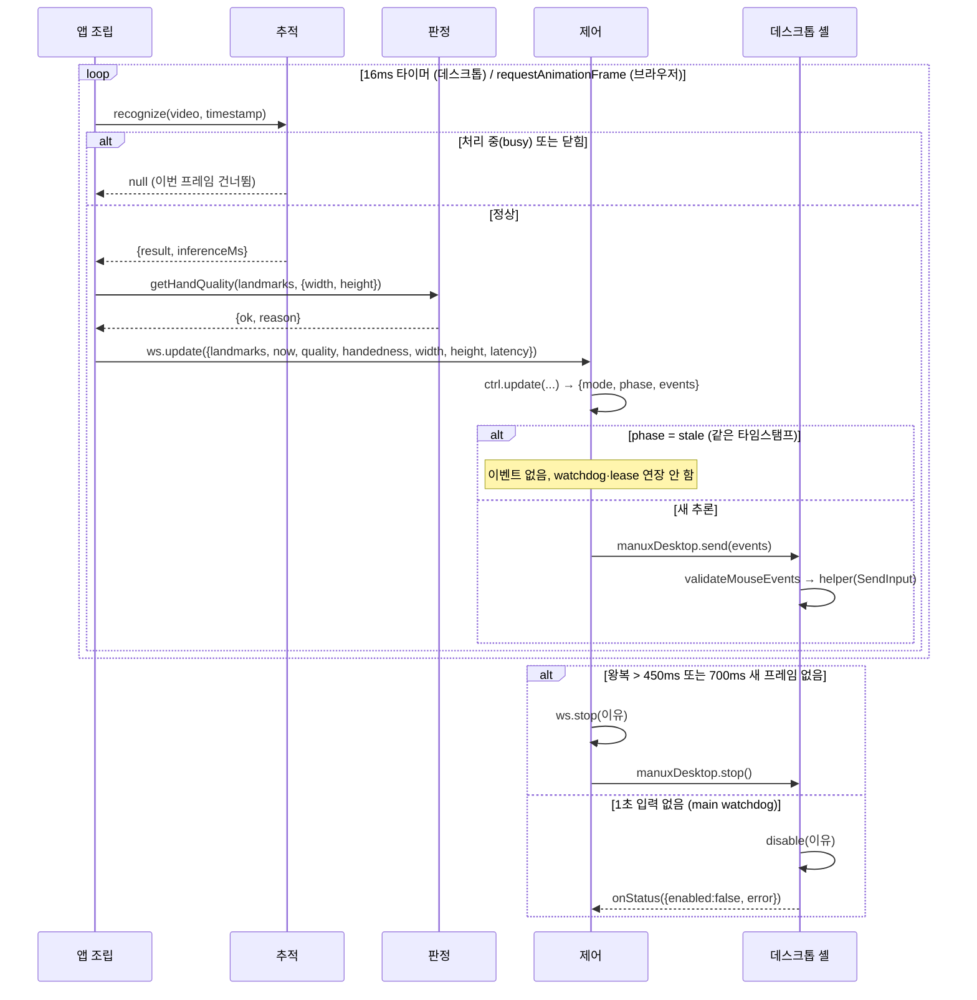
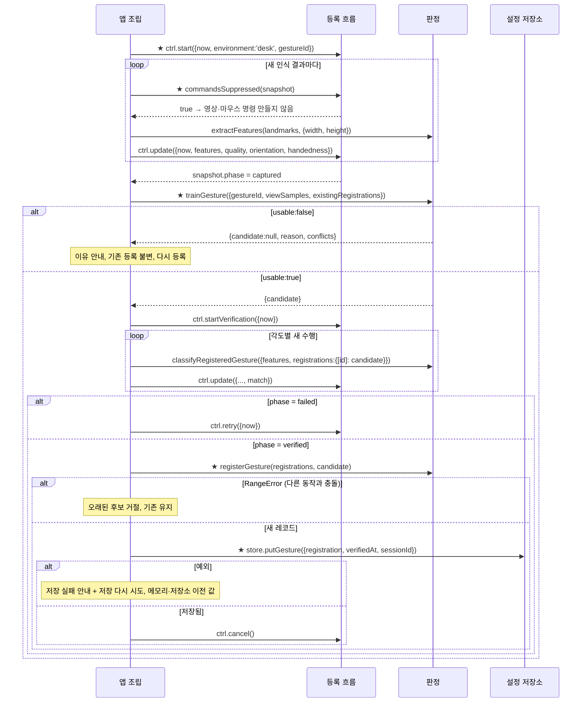
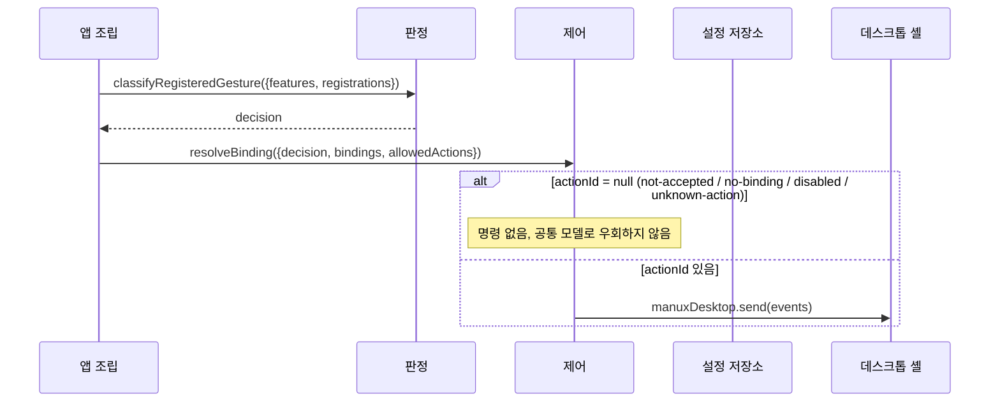
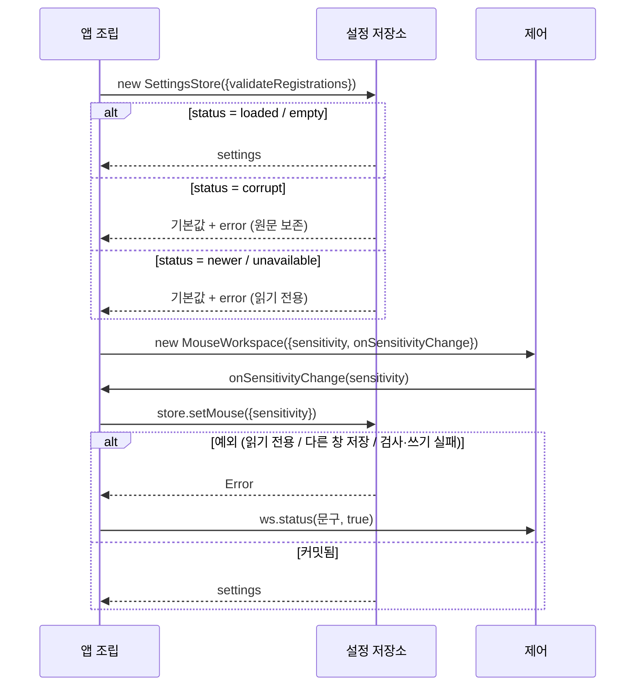

# 04. 시퀀스 다이어그램 (M1)

> 상태: **AI 초안, 사람 검수 전** (2026-11-03). 입력: [03 인터페이스](03-interfaces.md). participant 이름은 [02 컴포넌트](02-components.md)와 같고, 화살표 라벨은 03에 있는 함수만 쓴다. 새 정보를 만들지 않는 문서다 — 순서가 03과 다르면 이 문서가 틀린 것이다.
>
> GitHub와 VS Code 미리보기(Mermaid 확장)에서 렌더해 화살표 방향을 눈으로 확인한다.

## S-1. 프레임 하나가 Windows 커서가 되기까지 (UC-01·UC-02)

- 마우스 모드에서는 판정의 특징 벡터·등록 판정을 쓰지 않는다. 핀치·손바닥 판정은 제어(`AirMouseController`) 안에 있다.
- 시간 초과 시 `recognize`는 reject하고 앱 조립은 `stopCamera()`로 세션 전체를 끝낸다(그림 생략).

## S-2. 손 모양 하나 등록 (UC-04)

앱 조립 쪽 단계(★)는 **아직 코드에 없는 제안 경로**다(U2). 다른 화살표의 함수는 구현돼 있다.

- 취소·Esc·창 이탈·카메라 종료는 어느 단계에서든 `ctrl.cancel()` 하나로 끝난다(그림 생략).
- `store.putGesture` 전에 `registerGesture`를 부르는 이유: 저장소는 충돌을 모른다. 충돌 재검사는 판정의 책임이다.

## S-3. 등록 동작 → 액션 실행 (UC-05, 제안)

전부 **제안**이다(C3). `resolveBinding`은 03의 제안 시그니처다.

`bindings`는 앱 조립이 `store.settings`에서 읽어 넘긴다. 제어는 설정 저장소를 직접 부르지 않는다(02의 의존 방향).

## S-4. 시작할 때 설정 복원과 변경 저장 (UC-06)

