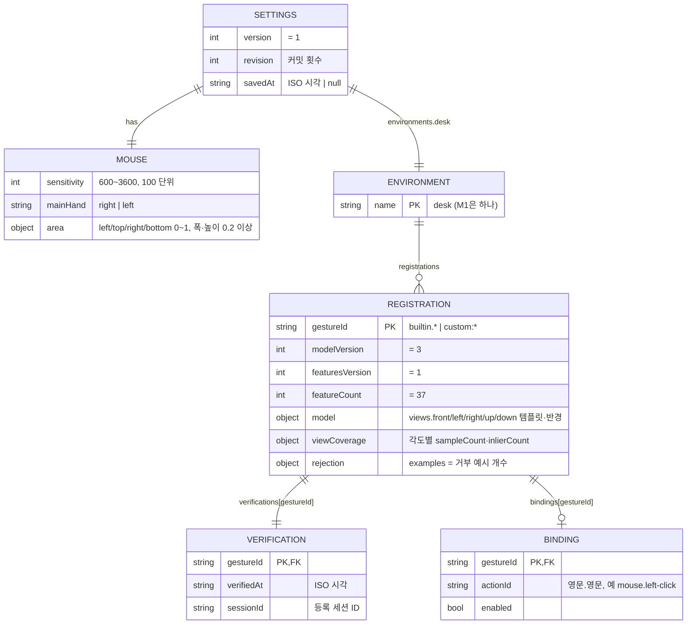
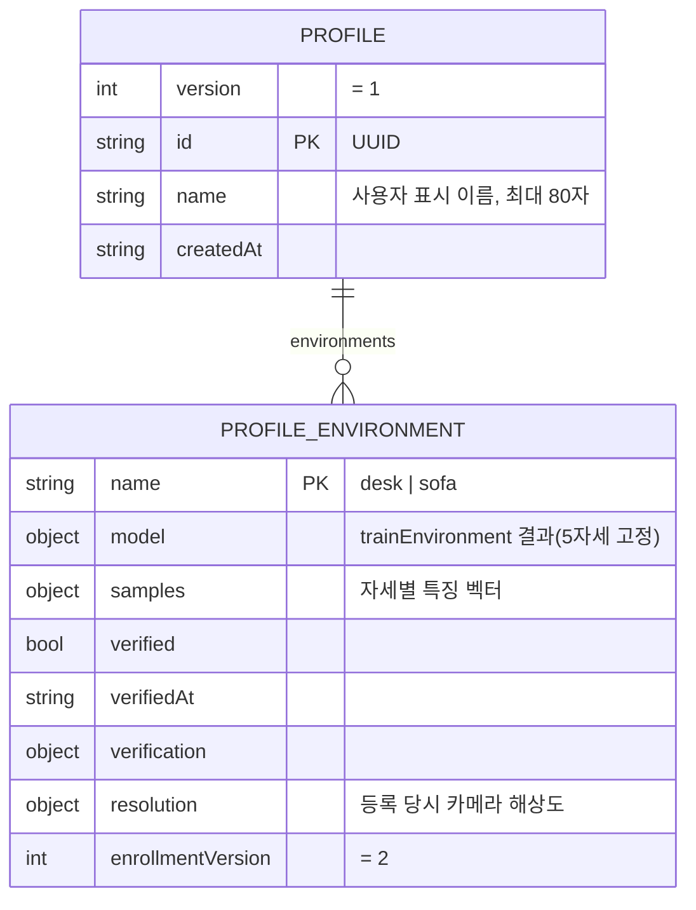

# 05. ERD — 저장 데이터 (M1)

> 상태: **AI 초안, 사람 검수 전** (2026-11-03). 입력: [01 유스케이스](01-use-cases.md), [03 인터페이스](03-interfaces.md), [settings-store](../settings-store.md). 데이터베이스는 없다. 브라우저/Electron `localStorage`의 JSON 레코드 두 개를 엔티티로 그렸다. 원시 웹캠 영상·이미지는 어디에도 저장하지 않는다.

## 설정 레코드 `manux.settings.v1` (마우스 모드, M1)

제약(검증기가 강제):

- 모든 `REGISTRATION`에 `VERIFICATION`이 정확히 하나 있다. 확인 없이 저장할 수 없다.
- `VERIFICATION`·`BINDING`은 등록된 `gestureId`만 가리킨다. 등록을 지우면 둘 다 함께 지운다.
- `REGISTRATION`에는 `actionId`가 없다. 동작과 액션은 `BINDING`으로만 이어진다.
- 등록은 최대 12개, 직렬화 2,000,000자 이하.
- 키 `manux.settings.v1.backup`: 손상된 원문을 첫 저장 전에 한 번 복사한 사본(같은 형식이 아닐 수 있음).

## 영상 모드 프로필 `manux.profiles.v1` (UC-08, 유지)

설정 레코드와 키·형식을 공유하지 않는다. 같은 `localStorage` 할당량(약 5MB)을 나눠 쓴다.

## 칼럼 출처

| 칼럼 | 근거가 된 유스케이스 문장 |
| --- | --- |
| `SETTINGS.version` | UC-06 "더 새 버전이 저장한 값 → 읽기 전용" |
| `SETTINGS.revision` | 근거 없음 — **제안**. 충돌 감지는 원문 비교로 하므로 진단용 카운터일 뿐이다 |
| `SETTINGS.savedAt` | 근거 없음 — **제안**. 진단용 |
| `MOUSE.sensitivity` | UC-06 "감도… 다시 열어도 같은 값", UC-02 "감도 변경 → 제어 끔" |
| `MOUSE.mainHand` | UC-06 "주손" |
| `MOUSE.area` | UC-06 "제어 영역" — 판정기가 아직 쓰지 않음 |
| `ENVIRONMENT.name` | UC-04 사전조건(책상 프리셋). 소파는 제안 절 |
| `REGISTRATION.gestureId` | UC-04 "다른 등록을 건드리지 않고 하나를 추가·재등록" |
| `REGISTRATION.modelVersion`·`featuresVersion`·`featureCount` | UC-06 "업데이트 후에도 같은 값으로 시작"(형식이 바뀌면 거절해야 함) |
| `REGISTRATION.model` | UC-04 "5개 각도 표본 수집 → 후보 학습" |
| `REGISTRATION.viewCoverage` | UC-04 "한 각도 확인 실패 → 그 각도만" — 간접 근거, 화면 안내용 |
| `REGISTRATION.rejection` | UC-04 제안 "거부 예시 필수 여부" — 결정 전까지 개수만 기록 |
| `VERIFICATION.*` | UC-04 "확인 통과 → 저장", 예외 "후보 학습 뒤 다른 동작이 먼저 저장됨" |
| `BINDING.actionId`·`enabled` | UC-05 "연결 없음·비활성·허용 목록에 없는 액션 → 명령 없음" |
| `PROFILE.name` | UC-08(기존). 개인 이름이 들어갈 수 있으므로 시험 fixture에 실제 이름을 쓰지 않는다 |

역추적: UC-04 "기존 동작을 조용히 끄지 않는다"는 칼럼이 아니라 `registerGesture`가 충돌 시 예외로 저장을 막는 제약으로 구현된다. UC-05 "실행 실패를 성공으로 기록하지 않는다"는 저장 칼럼이 없다 — 진단 사건 기록(contracts §7)은 아직 저장 형식이 정해지지 않았다.
