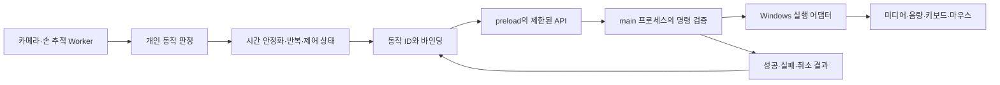

# MANUX 데스크톱 HMI 제품 방향

작성일: 2026-10-29. 이 문서는 앞으로의 제품 설계안이다. 현재 실행 프로그램은 로컬 브라우저에서 자신의 영상 플레이어를 제어하며, Electron 패키지·사용자 임의 동작 추가·OS 명령 실행은 아직 구현하지 않았다. 이번 구현 범위는 기존 네 명령을 유지하는 각도별 온보딩이다.

## 기술을 어떻게 설명할 것인가

현재 구현의 적절한 표현은 **“사전학습된 손 추적 모델과 사용자별 특징 등록을 결합한 제스처 인터페이스”**다. 제품 목표까지 포함하면 **“사용자 적응형 제스처 인식·바인딩 기반 데스크톱 HMI”**라고 설명할 수 있다.

`src/vision-worker.js`는 기존 MediaPipe 모델을 불러와 추론한다. `src/personalization.js`는 21개 관절에서 37개 각도·거리비 특징을 계산하고, 등록 예시·대표값·거부 기준을 구성한다. 현재 코드에는 신경망의 역전파, optimizer, 사전학습 가중치 갱신이 없다. 따라서 사용자 등록을 **개인 분류 모델 구성·보정**이라고 할 수 있지만, 사전학습 모델 파인튜닝이라고 부르기는 어렵다.

| 방식 | 실제로 바뀌는 것 | 사용할 표현 |
| --- | --- | --- |
| 현재 사용자 등록 | 특징 예시, 대표값, 허용 거리와 거부 기준 | 개인화, 사용자 보정, 예시 기반 분류 |
| 고정된 특징 추출기 위에 새 신경망 분류기 학습 | 새 분류기의 학습 가능한 가중치 | 분류 헤드 학습, 전이학습 |
| 사전학습 모델 일부 또는 전체를 추가 데이터로 재학습 | 기존 학습 가중치 | 파인튜닝 |

TensorFlow 공식 가이드도 고정한 기반 모델 위의 새 층 학습과, 기존 층을 풀어 재학습하는 파인튜닝을 구분한다. [TensorFlow 전이학습·파인튜닝](https://www.tensorflow.org/guide/keras/transfer_learning)

MediaPipe Model Maker에는 데이터셋·검증셋과 학습률 등을 사용해 사용자 정의 제스처 모델을 학습·내보내는 별도 경로가 있다. 현재 앱이 그 학습 파이프라인을 실행하는 것은 아니다. 나중에 도입한다면 실제로 학습한 컴포넌트와 고정한 컴포넌트를 구분해서 보고한다. [MediaPipe 제스처 모델 커스터마이징](https://developers.google.com/edge/mediapipe/solutions/customization/gesture_recognizer)

머신비전은 제품의 입력 기술이다. 등록 사용성, 모호한 입력 거부, 동작 바인딩, OS 실행, 취소·복구와 사용자 검증이 더해지면 HMI 제품이 된다. 신경망을 파인튜닝하는지와 제품의 완성도는 별도로 평가한다.

## 사용자가 경험할 흐름

2026-10-29 후속 요구에 따라 장기 제품은 **키보드·마우스와 함께 쓰는 제스처 입력**을 지향한다. 현재 등록 과부하·실패 해결과 기본 동작별 독립 등록이 먼저이며, 우선순위는 [마스터 플랜](master-plan.md)을 따른다. 아래의 사용자 정의 동작·바인딩은 아직 설계 단계다.

1. 처음에는 현재 네 동작과 영상 제어 기본 바인딩을 제공한다.
2. 사용자가 새 손 모양에 이름을 붙이고 여러 각도로 등록한다.
3. 기존 동작과 구분 가능한지 확인한 뒤 동작 목록에 추가한다.
4. 동작에 음량·미디어·단축키·허용된 매크로를 연결하고 미리 시험한다.
5. 제어를 켜고 사용하며, 중지 단축키나 트레이에서 언제든 해제한다.

초기 사용자 정의 동작은 **정적인 한 손 모양**으로 범위를 정하는 편이 좋다. 손을 흔들거나 원을 그리는 시간적 모션은 궤적·속도·시퀀스 판정이 추가로 필요한 별도 기능이다. 각도 변화에 강하게 인식할지, 방향 자체를 다른 명령으로 사용할지는 동작 정의의 속성으로 구분한다.

현재 네 명령의 이름과 인식 클래스는 연결되어 있다. 확장할 때는 `GestureDefinition`, `ActionDefinition`, `Binding`을 별도 데이터로 분리한다. 예를 들어 `gestureId: custom-01`은 “내 집게손”을 뜻하고, 사용자는 그 ID에 `volume.up` 또는 `shortcut.alt-tab`을 연결한다. 기존 프로필은 마이그레이션하며 기본 바인딩으로 계속 사용할 수 있어야 한다.

## Electron과 OS 실행 경계

Electron은 Windows·macOS·Linux용 데스크톱 프레임워크다. 향후 Android는 별도 앱과 실행 어댑터로 만든다. Android용 MediaPipe 예제를 활용할 수 있지만, 프로필 스키마·동작 ID·명령 의미를 공유하는 것과 카메라 수명주기·OS 실행 코드를 그대로 공유하는 것은 다르다. [Electron 소개](https://www.electronjs.org/docs/latest/), [MediaPipe Android 예제](https://github.com/google-ai-edge/mediapipe-samples/blob/main/examples/gesture_recognizer/android/README.md)

키보드는 기존 입력으로 계속 사용하고, 후속 기능에서 명시적인 단축키나 모드 키와 제스처를 함께 명령 조건에 넣는 방식을 검토한다. 키 놓음·포커스 전환·앱 종료 시 상태를 해제하고 키가 눌린 채 남지 않는지 확인한다. 현재 웹 데모의 Esc 중단 외에 이러한 결합 제어가 구현됐다는 뜻은 아니다.

Android의 다른 앱 제어는 플랫폼이 허용하는 API와 사용자가 켠 서비스 권한 안에서 별도 검토한다. `AccessibilityService`의 전역 동작과 `dispatchGesture`는 가능한 경로 중 하나이며, 사용 가능 동작·선언된 기능·권한이 필요하다. 카메라 손동작 인식만으로 모든 앱과 OS 기능을 제어할 수 있다고 약속하지 않는다. [Android AccessibilityService](https://developer.android.com/reference/android/accessibilityservice/AccessibilityService)

Electron UI에는 기존 화면과 카메라·Worker 처리를 이식할 수 있다. OS 실행은 main 또는 별도 네이티브 helper가 맡는다. renderer는 `contextIsolation: true`, `nodeIntegration: false`를 유지하고, preload는 `runAction(actionId, validatedArgs)`처럼 범위가 제한된 API만 제공한다. main은 허용 명령·인자·호출 출처·현재 제어 상태를 다시 확인한다. 임의 쉘 문자열이나 모든 IPC 채널을 UI에 노출하지 않는다. [Electron Context Isolation](https://www.electronjs.org/docs/latest/tutorial/context-isolation), [Electron 보안 지침](https://www.electronjs.org/docs/latest/tutorial/security)

`globalShortcut`은 앱 밖에서도 단축키 입력을 등록·감지하는 기능이다. 제스처에서 다른 앱으로 키를 보내는 실행 어댑터와는 역할이 다르다. [Electron globalShortcut](https://www.electronjs.org/docs/latest/api/global-shortcut)

| 원하는 동작 | Windows에서 검토할 경로 | 제품에서 정의할 의미 |
| --- | --- | --- |
| 음량 증가·감소·음소거 | 음량 키 이벤트 또는 오디오 API | 변화량, 유지 반복, 최대·최소 범위 |
| 미디어 재생·일시정지 | 미디어 키 또는 지원 세션의 미디어 제어 API | 재생·정지·토글을 별도 명령으로 표시 |
| Alt+Tab·단축키 | 네이티브 키 입력 어댑터 | 누름·떼기 순서와 취소 시 키 해제 |
| 마우스 커서·클릭 | 네이티브 마우스 입력 어댑터 | 좌표 보정, 흔들림 완화, 클릭과 이동의 분리 |
| PC 종료 | Windows 종료 API | 별도 확인·취소 가능한 대기, 기본 반복 금지 |

Windows `SendInput`은 키보드·마우스 입력을 합성한다. 같은 권한 수준 또는 더 낮은 권한 수준의 앱으로만 입력을 주입할 수 있으므로 모든 창 제어를 보장하지 않는다. 실행 결과와 실패를 기록해야 한다. [Microsoft SendInput](https://learn.microsoft.com/en-us/windows/win32/api/winuser/nf-winuser-sendinput)

Windows에는 `VK_VOLUME_UP`, `VK_VOLUME_DOWN`, `VK_MEDIA_STOP`, `VK_MEDIA_PLAY_PAUSE` 같은 의미가 정해진 키 코드가 있다. 마지막 것은 재생/일시정지 토글이다. 현재 앱의 “재생”과 “일시정지”처럼 분리된 의미를 그대로 보장하려면 대상 세션의 상태·지원 기능을 확인해야 한다. 지원 세션에는 별도 `TryPlayAsync`·`TryPauseAsync` 경로가 있다. [Windows 키 코드](https://learn.microsoft.com/en-us/windows/win32/inputdev/virtual-key-codes), [TryPlayAsync](https://learn.microsoft.com/en-us/uwp/api/windows.media.control.globalsystemmediatransportcontrolssession.tryplayasync), [TryPauseAsync](https://learn.microsoft.com/en-us/uwp/api/windows.media.control.globalsystemmediatransportcontrolssession.trypauseasync)

따라서 사용자에게는 “Fn+어떤 키”를 요구하기보다 **“음량 올리기”, “재생/일시정지”라는 동작을 바인딩**하게 한다. Fn/F Lock과 대체 기능의 배치는 키보드마다 다를 수 있다. [Microsoft Fn·F Lock 안내](https://support.microsoft.com/en-us/surface/accessories/mouse-keyboard/how-do-i-use-the-fn-key-f-lock-key-alternate-command-keys)

PC 종료는 독립된 기능이다. 예를 들어 `ExitWindowsEx`는 지정한 종료 유형에 맞는 권한과 동작 조건을 요구한다. 이번 온보딩 변경에서는 종료 API나 실제 종료 명령을 실행하지 않는다. [Microsoft ExitWindowsEx](https://learn.microsoft.com/en-us/windows/win32/api/winuser/nf-winuser-exitwindowsex)

커서 이동은 매 프레임의 연속 좌표를 다루므로, 300ms 확정 후 한 번 실행하는 현재 명령 판정기와 별도 경로로 설계한다. 매크로는 명령 단계·기다림·취소·실패 결과를 가진 실행기로 분리하고, 반복 옵션을 모든 OS 동작에 일괄 적용하지 않는다.

## 5인·2주에서 정할 현실적인 다음 범위

2026-10-29의 등록 과부하·실패 피드백을 반영한 최신 범위는 [마스터 플랜](master-plan.md)을 따른다. 이 문서 위의 Electron·OS 구조는 후속 설계이며 첫 2주의 완료 약속이 아니다.

- **P0:** 실제 등록 실패의 단계와 원인을 재현하고, 기본 동작 하나씩 수집·확인·저장한다. 재등록·취소·실패에서 다른 유효 등록을 보존하고 실제 책상·소파 조건에서 평가한다.
- **P1:** P0 인수와 남은 시간을 확인한 뒤 rock 등 사용자 정의 정적 손 모양과 **앱 내부 영상 액션** 바인딩으로 확장한다.
- **후속:** Electron 패키징, 키보드 결합 제어, Windows 미디어·음량·단축키, 커서·매크로·PC 종료, Android 실행 경로를 별도 범위로 개발한다.

D1~D2는 실패 재현과 계약 확정, D3~D5는 단일 동작 등록의 전체 연결, D6~D8은 실물 평가·수정, D9~D10은 회귀·다른 PC 실행·발표 증거에 배분한다. 이는 약 10영업일의 작업량 가정이며 실제 투입 시간에 맞춰 조정한다.

담당·브랜치·리뷰어와 세부 작업은 [역할별 작업 지침](workstreams/), 저장·판정·바인딩 경계는 [모듈 계약](contracts.md)을 따른다. Jira의 기존 범위에 반영할 변경은 [Jira 변경 제안](jira-change-proposal.md)에 구분했다. 코드가 존재하거나 계획을 작성했다는 이유로 구현·실물 검증 완료로 표시하지 않는다.
