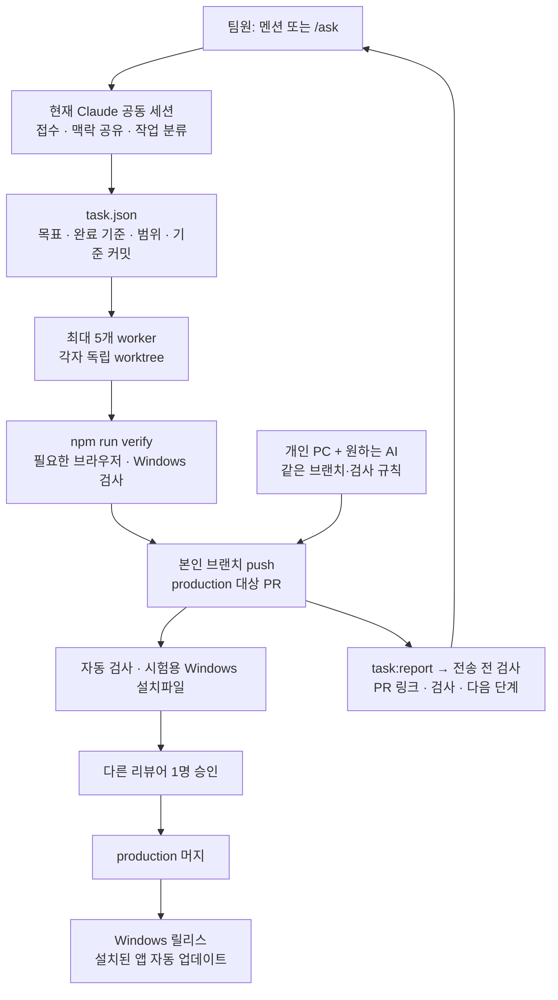

# MANUX 공동 작업 하네스

하네스는 AI가 작업을 접수하고, 코드를 바꾸고, 검사하고, 결과를 설명하는 공통 절차다. 같은 질문 문구를 반복하는 대신 저장소의 규칙·결과 계약·실행 검사로 팀 전체의 기준을 맞춘다.

## 팀원이 할 일

Discord에서 `@1조봇` 또는 허용된 `/ask`에 **목표, 현재 문제, 완료됐다고 볼 조건**을 평소 말로 적는다. 예: “등록 취소 후 이전 프로필이 사라집니다. 취소해도 이전 프로필이 유지되게 고치고 재현 테스트도 추가해 주세요.” JSON·Git·터미널을 몰라도 조정자가 요청을 정리한다.

단순 질문은 바로 설명한다. 코드 작업은 목표·완료 기준·허용 파일·작업 브랜치의 실제 기준 SHA를 `task.json`에 기록한다. 신규 작업은 최신 원격 production에서 시작하며, 진행 중 작업은 기존 경로·브랜치·변경을 보존한다. 모호함이 실제 동작을 바꿀 때만 질문한다. 모든 사용자가 같은 규칙과 검사 흐름을 이용한다.



5개는 **Discord 호스트의 동시 worker 수**다. 개인 PC에서 개발하는 팀원의 수를 제한하지 않는다. 6번째 Discord 작업은 대기하며 의존 작업과 충돌은 PR에서 조정한다. 신규 worker는 원격 production의 깨끗한 커밋과 시작 시점의 대화 맥락을 받는다. 공유 checkout의 미커밋 소스는 복제하지 않는다. 이후 결정은 조정자가 전달한다. 모든 worker의 내부 대화나 파일이 실시간으로 자동 합쳐지지는 않는다.

## 작은 규칙 집합

| 파일 | 역할 |
| --- | --- |
| `AGENTS.md` | 도구와 사용자에 관계없는 공통 작업·검증·보고 기준 |
| `CLAUDE.md` | `AGENTS.md`를 읽도록 연결; 중복 규칙을 두지 않음 |
| `harness/task.schema.json`, `result.schema.json` | 입력·결과 계약과 허용 상태 |
| `scripts/task-contract.mjs`, `task-report.mjs` | 계약 검사와 결정적인 보고서 생성 |
| `.claude/agents/manux-reviewer.md` | 결과·diff·검사 로그를 읽는 독립 리뷰어 |
| `.claude/settings.json`, `scripts/discord-output-guard.mjs` | Discord 답변/수정 전 양식과 최종 기록 검사 |
| `.github/workflows/` | PR 검사·시험용 설치파일과 production 릴리스 workflow |

규칙은 짧게 유지하고 세부 내용은 필요할 때만 읽는다. 별도 AI 플랫폼이나 100개의 에이전트를 설치하지 않는다. 조정자가 직접 처리할 수 있는 짧은 안내에 worker나 전체 검사를 붙이지 않는다.

## 결과 계약과 실제 증거

조정자/worker는 `.local/harness/<requestId>/`에 `task.json`, `result.json`을 기록한다. Git에 포함되지 않는 로컬 작업 기록이므로 파일을 삭제하면 사라진다. 재부팅 후 조정자는 이 기록과 보존된 worktree를 확인하며, 종료된 worker가 계속 실행 중이라고 가정하지 않는다. 공유할 결정과 사용법은 관련 `docs/`에도 반영한다.

신규 Discord worker에는 조정자가 작성한 task.json의 절대 경로를 전달한다. 공유 `.local`은 새 worktree에 자동 복제되지 않으므로 worker가 자기 `.local/harness/<requestId>/task.json`에 사본을 둔다. 구현 전에 사본의 `baselineCommit`을 자기 `.local/discord-baseline.json`의 `sourceHead`로 확정한다. 생성 훅이 접수 때보다 최신 production을 조회할 수 있으므로 접수 시점의 SHA나 공유 checkout의 HEAD로 덮어쓰지 않는다. 기존 진행 중 작업의 기준은 유지한다. 완료 후 조정자는 확정된 task.json과 result.json 둘 다 공유 checkout의 같은 위치에 복사한 뒤 보고서를 생성한다. 결과만 복사해서 서로 다른 기준의 기록을 조합하지 않으며 worker의 원본 기록도 보존한다.

```powershell
npm run harness:check
npm run task:report -- .local/harness/작업ID/task.json .local/harness/작업ID/result.json
```

실제 ID는 영문·숫자·`_`·`-`로 만든다(예: `discord-1560000000000000000`). `harness/*.example.json`은 따라 쓸 예제이며 실제 검사를 실행한 기록이 아니다. 조정자가 새 요청의 기준 커밋·범위·완료 기준으로 바꾼다.

결과는 완료 기준별 증거, 실제 실행 명령과 결과, 변경 파일, 남은 한계, 다음 단계를 포함한다. `complete`는 모든 명시적 완료 기준과 검사가 통과한 작업에만 쓴다. 검토나 실제 기기 시험이 남았으면 `needs_review`, 진행할 수 없는 의존성이 있으면 `blocked`다. `delivery.integrated`는 production 반영 여부이고 `delivery.published`는 GitHub 게시 여부다. PR 생성·머지·설치본 게시를 각각 기록한다. worker에서 끝난 코드가 곧 배포된 앱을 뜻하지 않는다.

Discord의 최종 답변은 `task:report`가 만든 본문을 그대로 사용한다. 전송 전 훅은 공유 checkout에 저장한 기록을 다시 검증하고 본문과 비교한다. 접수·진행·질문·정보 답변도 같은 다섯 항목을 사용하지만 최종 결과 파일은 요구하지 않는다.

```text
상태: 접수 | 작업: discord-1560000000000000000
요약: 등록 취소 시 기존 프로필을 보존하도록 확인합니다.
변경: 아직 없음
검증: 재현 및 회귀 검사를 진행할 예정
다음: 독립 작업 폴더에서 원인을 조사합니다.
```

**자동 계약 검사는 형식·범위·증거의 유무와 상태 모순을 검사한다. 증거 내용이 사실인지 증명하는 장치는 아니다.** 실행 로그·독립 리뷰·CI가 함께 필요하다. 실제 웹캠/실제 OS 동작을 확인하지 않았다면 합성 브라우저 시험이나 Windows dry-run만으로 확인했다고 쓰지 않는다.

## 검사와 전달

`npm run verify`는 로컬과 CI가 함께 쓰는 기본 진입점이다. 검사 준비·명령·실패 해결은 [CONTRIBUTING](../CONTRIBUTING.md)을 따른다. 개인 계정·봇 토큰·카메라 없이 기본 검사가 가능하다. 브라우저와 Windows 경로는 별도 검사로 보완한다.

PR에는 목표, 실제 검사 결과, 리뷰할 한계와 Jira 번호(있는 경우)를 적는다. 다른 사람의 파일을 삭제하거나 자신의 변경으로 묶지 않는다. 코드는 본인 브랜치에서 바로 production 대상 PR로 전달한다. 공유 checkout에는 Discord 전송용 보고 기록만 모은다. 로컬 성공과 GitHub CI 성공을 구분한다.

PR workflow는 자동 검사와 **시험용 Windows 설치파일**을 제공한다. production은 필수 검사와 다른 리뷰어 승인을 거쳐 머지하며, 릴리스 workflow가 해당 production 커밋을 검증·패키징하여 GitHub Release에 게시한다. 설치된 앱은 게시된 정식 버전을 확인한다. 릴리스 상세와 서명 상태는 [데스크톱 배포](desktop-release.md)를 따른다. 기존 source handoff는 별도의 소스 전달 보조 도구다. workflow 파일이 머지되기 전에는 새 배포 흐름이 원격에서 활성화된 것으로 보고하지 않는다.

## 호스트와 팀원 환경

공동 Discord 접수에는 호스트 PC의 Claude·Bun Discord 채널·Node `/ask` 서비스가 실행 중이어야 한다. 기존 `discord_bot.bat` 실행기는 세 프로세스를 함께 준비하고 전용 Claude 세션을 재개한다. 현재 Windows 자동 시작 등록은 하지 않았으므로 재부팅 후 실행해야 한다. 개발 채널 안내가 나오면 본인 로컬 개발 채널 선택을 확인한다.

팀원이 자기 PC에 저장소를 복제하면 코드·검사·규칙을 공유한다. 호스트의 로그인 상태·봇 토큰·대화 기록·`.local` 파일은 따라오지 않는다. 자체 봇 토큰을 배포하거나 같은 토큰으로 여러 봇 프로세스를 켜지 않는다.

## 참고한 원칙

- [Anthropic의 장기 실행 하네스 사례](https://www.anthropic.com/research/effective-harnesses-for-long-running-agents): 작은 작업 단위, 지속 기록, 실제 검사 근거.
- [Claude Code best practices](https://code.claude.com/docs/en/best-practices): 간결한 공통 지침, 검증 가능한 완료 기준, 필요한 맥락만 로드.
- [Claude Code hooks](https://code.claude.com/docs/en/hooks): 프롬프트 외에 도구 실행 전 조건 검사.
- [harness-100](https://github.com/revfactory/harness-100): 구조화된 결과·역할 분리·작업 규모별 실행 방식을 참고. 템플릿 전체를 복사하지 않고 MANUX의 5인 협업에 필요한 부분만 적용했다.
