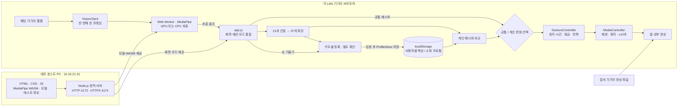

# LAN 데모

2026-10-29 설정. 호스트 LAN 주소는 `10.10.21.31/24`다.

| 용도 | 주소 |
| --- | --- |
| 카메라 포함 데모 | <https://10.10.21.31:4174> |
| 화면 확인 | <http://10.10.21.31:4173> |
| 기존 호스트 전용 데모 | <http://127.0.0.1:4173> |

Edge/Chrome으로 HTTPS 주소를 열고 데모의 로컬 인증서를 확인·허용한 다음 카메라 권한을 허용한다. 자체 서명 인증서이므로 처음에는 인증서 경고가 표시된다. 기관 브라우저 정책으로 예외 진행이 차단된다면 기관에서 신뢰하는 인증서로 교체해야 한다. 인증서 확인 없이 모든 사이트의 인증서 검사를 끄는 브라우저 옵션은 필요하지 않다.

카메라 API는 HTTPS 또는 localhost 같은 보안 컨텍스트에서 사용할 수 있다. [MDN getUserMedia](https://developer.mozilla.org/en-US/docs/Web/API/MediaDevices/getUserMedia). HTTP LAN 주소에서는 화면은 열리지만 카메라는 사용할 수 없다.

각 기기는 **자신의 웹캠과 영상 파일**을 사용한다. 프로필은 기기·브라우저·주소별 localStorage에 따로 저장된다. 호스트의 카메라나 등록 프로필이 공유되는 구조가 아니다.

## 실행과 종료

프로젝트 폴더의 PowerShell에서 실행한다. 최초 모델·패키지 준비는 README의 설치 절차를 따른다.

```powershell
.\start-manux-lan.ps1
.\stop-manux-lan.ps1
```

시작 스크립트는 LAN IP에 HTTP 4173과 HTTPS 4174를 별도 프로세스로 연다. 기존 localhost 서버는 유지한다. 종료 스크립트는 저장한 PID·프로세스 생성 시각·실행 파일·앱 경로가 모두 일치하는 LAN 프로세스만 종료한다. 로그와 프로세스 기록은 `.local/lan/`에 있다. PC 재부팅 후에는 다시 실행해야 한다.

현재 Windows 네트워크 프로필은 Public이고, 기존 `Node.js JavaScript Runtime` 인바운드 TCP Allow 규칙이 해당 Node 실행 파일을 허용한다. 이 작업에서 기존 방화벽 규칙이나 공유기 설정은 변경하지 않았다. 서버는 `10.10.21.31` 인터페이스에 바인딩된다. 다른 기기에서 접속이 안 되면 같은 LAN인지와 기관의 단말 간 통신 제한을 확인한다. 실제 다른 PC에서의 접속은 별도 확인이 필요하다.

## 인증서 재생성

현재 인증서는 `10.10.21.31`, `127.0.0.1`, `localhost`용이며 **2026-11-28 15:35 KST**까지 유효하다. 공개 인증서 SHA-256 지문:

```text
EC:0A:9D:BB:FB:C2:49:E9:EB:2E:6B:76:97:DF:02:8E:EC:CA:35:15:1E:B1:13:4D:85:EA:89:9A:B2:56:73:E6
```

인증서·개인키는 웹 제공 범위 밖의 `.local/lan/`에 있고 Git에서도 제외한다. IP 변경·만료 시 서버를 종료한 후 OpenSSL로 다시 만든다. IP를 바꾸면 아래 SAN과 시작 명령의 주소도 함께 바꾼다. 재생성 후 지문은 달라진다.

```powershell
.\stop-manux-lan.ps1
New-Item -ItemType Directory -Path '.local/lan' -Force | Out-Null
"[req]`ndistinguished_name = req_dn`n[req_dn]" | Set-Content '.local/lan/openssl.cnf'
openssl req -config '.local/lan/openssl.cnf' -x509 -newkey rsa:2048 -sha256 -nodes -keyout '.local/lan/server-key.pem' -out '.local/lan/server-cert.pem' -days 30 -subj '/CN=MANUX LAN Demo' -addext 'subjectAltName=IP:10.10.21.31,IP:127.0.0.1,DNS:localhost' -addext 'basicConstraints=critical,CA:FALSE' -addext 'keyUsage=critical,digitalSignature,keyEncipherment' -addext 'extendedKeyUsage=serverAuth'
.\start-manux-lan.ps1 -LanAddress '10.10.21.31'
```

수동 서버 설정은 `HOST`, `PORT`, `TLS_KEY_FILE`, `TLS_CERT_FILE` 환경변수로 지정한다. 기본값은 기존 HTTP localhost다. TLS 파일 두 개 중 하나만 설정하거나 읽기에 실패하면 서버가 종료하며 HTTP로 대체하지 않는다.

## 이번 설정 검증

- 호스트에서 LAN IP의 HTTP·HTTPS `/health` 응답과 TLS 인증서·IP 일치를 확인했다.
- HTML, 앱·Worker 코드, WASM, 모델, 테스트 영상, 영상 Range 응답을 확인했다. 개인키 경로는 HTTP 403으로 차단됐다.
- 격리된 Chrome에서 해당 HTTPS 주소의 보안 컨텍스트·카메라 API·89.5초 테스트 영상·실제 MediaPipe 처리까지 확인했다. 카메라는 합성 장치이며 실물 웹캠 인식률 검증은 아니다. 테스트 브라우저에서만 자체 서명 인증서 예외를 허용했다. 첫 카메라 준비 검사에서 시간 초과가 있었고 재실행에서 통과했다.
- `npm test`는 이 Windows 환경의 동시 자식 프로세스 생성 오류로 실패했다. 같은 시험을 `node --test --test-concurrency=1 tests/*.test.js`로 순차 실행하여 **128/128 통과**했다.
- LAN 서버 종료·재시작·중복 실행을 확인했고 기존 localhost 서버는 유지됐다. 다른 LAN 기기의 실제 접속은 아직 확인하지 않았다.

로컬 검사 결과는 `.local/lan/verification.json`, `.local/lan/unit-tests-serial.log`에 있다.

## 현재 아키텍처



서버는 정적 파일과 `/health`를 제공한다. 웹캠 프레임·개인 프로필을 서버로 전송하지 않으며 서버 DB와 서버 추론은 없다. 개인화는 특징 예시 기반 분류이고 MediaPipe 모델 가중치를 파인튜닝하지 않는다. 등록 중에는 영상 명령을 실행하지 않는다.

현재 개인 등록 실패 보고는 미해결이다. 동작 하나씩 독립 등록, 임의 손 모양·자유 액션 바인딩, Electron·OS 제어는 이후 개발 범위다.
