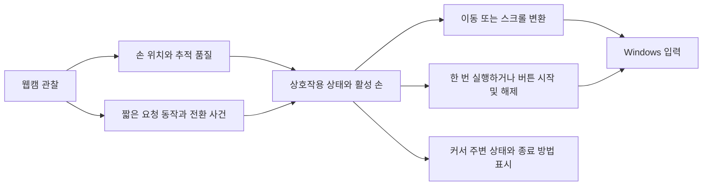

# M1 웹캠 마우스 제품 설계 검토

게시 범위: 설계 문서와 검증 계획만 포함한다. 구현·실제 사용자·RGB 웹캠·Windows 성능 검증 완료를 뜻하지 않는다. 기존 Jira 계획과의 차이 및 로컬 코드 관찰의 범위는 [게시 안내](publication.md)를 먼저 확인한다.

가정의 일반 웹캠과 Windows PC로 커서 이동·클릭·드래그·스크롤을 수행하는 데스크톱 앱을 설계한다. 기본 조작은 설치 후 준비되어 있어야 하며, 사용자가 원하는 동작과 컴퓨터 기능을 연결할 수 있어야 한다. 한 손과 두 손 중 어느 방식을 기본값으로 삼을지는 비교 검증으로 결정한다.

우선 검증할 가설은 **손모양으로 의도를 요청하는 과정과, 손의 위치로 연속 조작하는 과정을 분리하면 지속적인 자세 유지 부담과 제어 단절을 줄일 수 있다**는 것이다. 단계형이 피로를 줄이더라도 모드를 잊거나 종료를 누락하는 문제가 늘 수 있으므로 확정된 해법으로 취급하지 않는다. 제품 구현을 추가하는 대신 아래 설계안과 검증 계획을 검토한다.

## 검토 자료

회의에서 전체를 읽기 전에는 [제품 설계 결정표](review-sheet.md)로 핵심 검증 세 가지·비교 순서·요구별 근거와 미확인 증거를 먼저 확인한다. 세 가지는 질문의 묶음이며 모든 비교를 한 회차로 압축하는 일정이 아니다.

| 자료 | 검토할 내용 |
| --- | --- |
| 이 문서 | 제품 범위, 핵심 가설, 의사결정 순서 |
| [연구 근거](evidence.md) | 연구 결과와 적용 한계, 코드에서 확인된 결합 |
| [조작 시나리오](candidate-storyboards.md) | 한 손·두 손의 실제 조작 순서와 비교 후보 |
| [첫 사용과 사용자 설정](setup-and-customization.md) | 등록 없이 첫 클릭, 새 기능 연결·시험·저장·적용·복원 |
| [클릭 요청 규칙](event-grammar.md) | 닫힘·열림 확정, 포기·만료·드래그 전환, 더블클릭 |
| [상호작용 계약](interaction-contract.md) | 상태 전환, 휴식·재배치·추적 손실, 커스터마이징의 의미 |
| [검증 키트](study-kit.md) | 구현 전 개념 검증, 이후 센서 평가, 기록 양식과 채택 기준 |
| [Windows 혼합 과제](mixed-task-script.md) | 후속 실사용 평가의 33개 채점 시도와 휴식·비명령 관찰 |
| [개념 검증 진행 안내](facilitator-guide.md) | R0 단계형·R1 유지/단계 비교·R2 직접 버튼 대응의 논리 참조, 지시·상태 카드·인터뷰 |
| [데이터 검토](data-evidence.md) | 공개 자료의 용도와 제품별 행동·실패 기록의 차이 |
| [조작 자세와 참여 상태](posture-and-engagement.md) | 공중 동작 전제 재검토, 팔 지지, 읽기·타이핑과 제어의 경계 |

## M1에서 완료해야 할 사용자 작업

“제스처가 인식된다” 대신 아래 작업을 도움 없이 끝내는지를 평가한다. 평가용 큰 버튼에서의 성공과 일반 Windows UI에서의 성공은 구분한다.

| 작업 | 완료의 의미 |
| --- | --- |
| 포인팅과 선택 | 가까운 곳·먼 곳·작은 목표로 이동해 원하는 항목만 한 번 클릭 |
| 버튼 동작 | 좌클릭·우클릭·더블클릭을 구분하고 메뉴에서 다시 선택 |
| 지속 조작 | 파일 이동과 텍스트 선택을 드래그하고 의도한 지점에서 해제 |
| 문서 이동 | 세로 스크롤 후 원하는 링크나 항목을 선택 |
| 작업 전환 | 타이핑 → 포인팅 → 타이핑으로 돌아가며 의도하지 않은 입력 방지 |
| 휴식과 복구 | 손을 쉬고 다시 시작하거나 추적이 끊긴 뒤 커서 점프·명령 재실행 없이 복귀 |
| 개인 설정 | 기본값으로 먼저 사용하고, 필요한 시작·확정·종료 동작을 바꾼 뒤 같은 작업을 수행 |

사용자는 2026-11-03 M1의 우선 사용 환경을 **책상에서 일반 PC 작업**으로 확인했다. 작은 버튼 선택, 파일·문서 작업, 창 이동, 키보드와 포인팅의 왕복을 중심으로 평가한다. 단일 화면부터 비교하는 것은 변수를 줄이기 위한 검증 제안이며, 모니터 수·배율·카메라 배치·권한별 지원 범위까지 사용자 결정으로 확대하지 않는다. “영상 화면에서 잘 된다”만으로 Windows 앱 전반의 마우스 대체를 입증하지 않는다.

기본 동작 사용에 개인 손모양 등록을 필수로 두지 않는다. 초기 프리셋 개수와 이름보다 **모든 기본 프리셋이 공유할 조작 규칙**을 먼저 검증한다. 이번 설계 요구의 3종 프리셋은 상호작용 후보 3종과 다른 개념이며, 실험 조건을 그대로 제품 프리셋으로 출시하지 않는다.

## 현재 설계에서 바꿔 볼 핵심 전제

현재 등록형 제어는 매 프레임 손모양을 액션으로 변환하고, 액션이 사라지면 이동 상태까지 중단한다. 그러므로 손 위치가 추적되고 있어도 손가락 모양을 풀면 커서가 멈출 수 있다. 데이터 증가만으로는 이 조작 규칙이 바뀌지 않는다.

새 설계에서는 아래 세 질문을 분리한다.

1. **추적:** 지금 어느 손을 얼마나 신뢰할 수 있게 관찰하고 있는가?
2. **요청:** 사용자가 클릭·이동 시작·스크롤 시작·종료 등을 요청했는가?
3. **상태:** 지금 입력을 쉬는 중인가, 포인터를 움직이는가, 스크롤·드래그 중인가?

이는 제안한 개념 구조다. 특정 손모양을 알아보지 못한 것과 손 위치 자체를 잃은 것은 다른 사건이다. 단계형 후보는 전자의 상황에서 새로운 명령을 내지 않되 위치 추적을 계속 사용할 수 있어야 한다. 후자는 이동을 멈추고 복구 절차로 들어가야 한다. 관찰하지 못한 움직임을 예측해 계속 OS에 보내는 방식은 이 가설에 포함하지 않는다.

## 비교할 설계와 추천 순서

공중에서 손을 드는 자세 자체도 고정 요구로 두지 않는다. 사전 리허설에서 팔 지지·작은 작업 공간·책상 가까운 자세를 검토하고, 센서가 볼 수 있어야 할 영역을 정의한다. 편한 자세인지와 RGB 웹캠으로 접촉·위치를 추적할 수 있는지는 별도 질문이다. [자세와 참여 상태 검토](posture-and-engagement.md)에 비교 축을 정리했다.

물리 마우스 M과, 현재 발상의 자세 게이트를 공통 추적기·명령 문법에 적용한 A를 기준으로 둔다. A는 현재 앱 바이너리 전체를 뜻하지 않는다. 먼저 몸동작 시연으로 B1의 누름 유지와 B2의 단계형 문법을 선별한다. 선택된 B와 같은 문법을 두 손에 배분한 C를 정해 A/B/C를 비교한다. 실제 센서 평가에서 공통 추적기·감도·필터·화면 배율을 맞추고 M을 기준으로 추가한다. 한 번에 손 수·제스처·필터·감도·클릭 보정까지 모두 바꾸면 무엇이 효과를 냈는지 알 수 없다.

| 비교 | 질문 | 우선 관찰할 실패 |
| --- | --- | --- |
| 한 손 유지형과 한 손 단계형 | 드래그·스크롤만 시작·종료로 나누는 것이 유리한가? | 종료 누락·중간 해제·재진입 혼동 |
| A와 선정 한 손 B | 모양 유지가 없어지면 작업 흐름과 부담이 개선되는가? | 모드 망각·일상 손동작의 오입력 |
| 선정 한 손과 C | 다른 손에 명령을 맡기면 클릭과 포인터 이동의 간섭이 줄어드는가? | 두 손 가림·팔 부담·키보드 복귀 |
| 선정 후보와 M | 실제 마우스 작업을 어느 정도 대체하는가? | 작은 UI·드래그·복구에서 물리 마우스로 돌아감 |

일상적인 단일 클릭은 짧은 확정 사건으로 두는 후보를 우선 검토한다. 클릭 때마다 “클릭 도구 선택 → 실행”을 반복하는 비용은 별도로 정당화해야 한다. 스크롤·드래그처럼 지속되는 행동은 단계형의 이득이 클 가능성이 있으나, 종료 방법과 잊음 오류를 함께 시험한다.

추가 선행 검토에는 [G0 직접 누름/해제](event-grammar.md)를 포함한다. 닫힘에 down·열림에 up을 대응시키고 대상 앱이 클릭/드래그를 처리하게 하는 후보로, 현재 B1의 지연 판별과 다르다. 이 후보가 유력하면 유지형 기준과 대응 두 손 조건부터 개정한다. G1/G2의 완성된 클릭 한 쌍만이 가능한 설계라고 전제하지 않는다.

단계형의 진입은 짧은 직접 요청이나 화면의 도구 선택으로 설계할 수 있다. 화면 메뉴는 예시이며 필수 구조가 아니다. 직접 요청의 암기·구분 부담과 메뉴의 탐색·전환 비용을 구분한다. B1 전체 흐름과 메뉴형 B2를 비교한 결과를 상태 유지 한 요인의 효과로 단정하지 않는다.

## 사용자 설정의 범위

프리셋은 손모양 목록과 OS 명령 이름의 연결을 넘어, **어떤 상태에서 어떤 요청을 받아 무엇을 한 번 실행하거나 시작·종료하는지**를 담아야 한다. 다만 사용자가 상태 그래프를 직접 편집하게 만드는 것은 M1의 기본 사용 흐름으로 두지 않는다.

[설정 묶음 설계](setup-and-customization.md)는 한 번에 한 묶음 활성화, 누름/해제의 완결된 변경, 시험한 내용과 적용할 사본의 일치를 정한다. 사용자 묶음의 기능 범위와 실행 가능한 종료·중지 경로는 따로 검사한다. 일부 기능만 둔 사용자 묶음을 허용하는 것과 기본 제공 마우스 묶음의 전체 작업 요구 충족은 별도 판정이다.

| 사용자가 바꿀 수 있는 항목 | 보존할 규칙 |
| --- | --- |
| 주손, 시작·휴식 요청 동작 | 인식 자체만으로 제어가 켜지지 않음 |
| 클릭·우클릭·추가 기능의 짧은 동작 | 한 요청이 매 프레임 중복 실행되지 않음 |
| 드래그·스크롤의 시작·종료 동작 | 끝내는 방법이 항상 있으며, 의미가 서로 충돌하지 않음 |
| 감도와 편한 작업 범위 | 재배치·재인식 시 기준을 다시 잡아 점프 방지 |
| 추가 컴퓨터 기능 연결 | 기본 클릭·해제·중지 경로를 덮어쓸 때 충돌을 검토 |

관절 각도와 손가락 분리 정도를 사용자에게 과도하게 강요하는 제스처는 모델이 잘 인식해도 기본값 후보에서 재검토한다. 커스터마이징의 학습 비용과 등록 실패는 기본 프리셋의 사용성 평가와 분리해서 측정한다.

## 위치와 방향에서 무시할 변화와 보존할 변화

“각도·위치·방향에 상관없이 인식”과 “움직임으로 제어”에는 다른 조건이 필요하다. 같은 명령 모양이 화면의 다른 위치에 나타났다는 이유로 명령을 바꾸면 안 되지만, 이동 모드에서 사용자가 오른쪽으로 움직인 정보까지 제거하면 커서를 제어할 수 없다.

| 입력의 의미 | 줄이려는 영향 | 반드시 남길 정보 |
| --- | --- | --- |
| 같은 모양인지 판정 | 손의 화면 위치·크기·허용 범위 내 기울기 | 명령을 구분하는 손가락 관계 |
| 커서 이동 | 작은 관찰 잡음과 명령용 손가락 변화 | 화면 축에 대한 이동 방향·변위·속도 |
| 스크롤 | 진입 이전 이동·가로 흔들림 | 진입 이후 세로 이동과 종료 사건 |
| 요청 동작의 시작과 끝 | 인접 프레임 중복·짧은 오판정 | 수행 순서·시각·놓기·새 시도 |
| 두 손의 역할 | 출력 배열 순서 변화 | 지속적인 손 신원과 역할 |

이는 특징을 분리해 설계할 이유이며 모든 기울기·가림에서 추적할 수 있다는 보장이 아니다. 웹캠 좌표의 좌우 반전, 화면 좌표, 사용자 손의 좌우를 혼용하지 않도록 설계 단계에서 기준을 하나씩 정의한다.

## 구현 전에 남길 결정

| 항목 | 현재 제안 | 결정에 필요한 증거 |
| --- | --- | --- |
| 기본 조작 자세 | 손가락 힘을 빼고 팔을 낮게 둔 편한 자세 | 몸동작 시연과 실제 카메라 가시성 |
| 커서 좌표 | 손바닥 부근의 상대 이동을 우선 비교 | 클릭 전후 흔들림·긴 이동·작은 목표 |
| 활성화와 휴식 | 명시적 진입·종료와 커서 주변 상태 표시 | 타이핑·읽기·물 마시기 중 오실행 |
| 클릭 | 짧은 사건 후보를 비교 | 빠른 연속 클릭·누락·중복·포인터 흔들림 |
| 드래그·스크롤 | 유지형과 단계형 모두 검토 | 피로·정상 종료·손실·모드 망각 |
| 손 수 | 한 손 후보와 역할 분리 두 손 비교 | 정확도·부담·가림·키보드 병행 |
| 목표 환경 | 사용자 확인: 책상에서 일반 PC 작업 | 웹캠·조명·거리·화면 구성별 실패 범위 |

사용자 검증 전에 특정 pinch, 주먹, V 모양 등을 정답으로 확정하지 않는다. 문헌의 특수 센서·VR 결과는 집의 RGB 웹캠 성능으로 옮겨 주장하지 않는다. 기본 마우스 대비 작업 완결성, 오실행, 부담을 함께 통과한 조작안으로 구현 범위를 정한다.

검토 회의에서는 제품 사용 조건, 남길 후보, 정상 종료와 추적 손실의 처리, 기본값 채택 문턱을 결정한다. 회의 전까지 이 문서의 제안은 설계 가설이며 사용자 승인이나 실험 결과로 기록하지 않는다.
