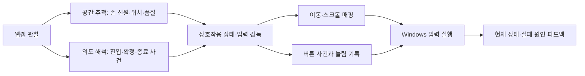

# M1 웹캠 마우스 상호작용 계약 검토안

> 게시 참고: 코드 결합에 대한 아래 관찰은 2026-11-03 로컬 미커밋 작업트리의 읽기 검토다. 원격 main 또는 릴리스 구현의 재현 근거가 아니다. 경로와 행 번호는 그 로컬 사본의 참고 위치이며, 게시 범위와 한계는 [publication.md](publication.md)를 따른다.

작성일: 2026-11-03. 이 문서는 설계 제안이며 현재 구현 또는 실사용 검증 완료를 뜻하지 않는다. 앱 코드·모델·기존 프리셋은 변경하지 않았다.

## 1. 목표와 검토 가설

M1은 가정의 웹캠으로 Windows의 기본 마우스 작업을 수행하는 데스크톱 앱이다. 설치 후 기본 동작을 바로 사용할 수 있고, 사용자는 필요한 의도 신호와 기능 연결을 바꿀 수 있어야 한다.

우선 검토할 가설은 **손 모양으로 의도를 선택한 뒤, 손가락 모양 유지와 독립적으로 손의 공간 이동을 제어에 사용하는 방식**이다. 한 손을 우선 비교하되 두 손의 역할 분리도 별도 후보로 평가한다. 이 가설이 더 편하거나 정확하다는 결론은 아직 내리지 않는다.

모든 작업을 두 단계로 만들지는 않는다. 이동은 지속 상태, 클릭은 일회 사건, 스크롤·드래그는 시작과 종료가 있는 작업으로 구분한다. 클릭할 때마다 별도 클릭 모드에 진입하는 후보는 추가 전환 비용을 함께 측정해야 한다.

### 후보별 적용 범위

이 문서의 주 전환표는 [후보 시나리오](candidate-storyboards.md)의 **B2·C2 상태 유지형 작업**을 구체화한 검토안이다. B1·C1의 누름 유지형 드래그에 같은 종료 규칙을 적용하지 않는다. 비교 조건·실험 순서는 [검증 키트](study-kit.md)를 따른다.

| 후보 | 위치가 유효하지만 일반 명령 모양이 미판정 | 드래그를 계속할 별도 근거 |
| --- | --- | --- |
| A · 연속 자세 게이트 | 현재 자세 게이트에 따라 중단될 수 있음. 비교를 위해 제거하지 않음 | 해당 액션 자세의 지속 판정 |
| B1 · 한 손 누름 유지 | 기본 포인터 이동은 계속 가능 | 접촉·누름 유지 근거가 유효해야 함 |
| B2 · 한 손 상태 유지 | 확정된 이동·스크롤·드래그 상태에서 위치 사용 가능 | 이미 확정한 시작 사건과 아직 오지 않은 종료 사건 |
| C1 · 두 손 누름 유지 | 주손의 포인터 이동은 일반 명령 모양과 분리 | 보조손의 접촉·누름 유지 근거가 유효해야 함 |
| C2 · 두 손 상태 유지 | 주손 위치와 확정된 작업 상태를 사용 | 시작·종료 사건. 보조손 소실 중 눌림 유지 정책은 별도 결정 |

B1·C1에서는 **일반 모양 미판정**, **필요한 접촉/누름 유지 근거 미판정**, **손 위치 추적 소실**이 세 가지 다른 사건이다. 접촉/누름 근거가 불확실해졌다고 무기한 button-down을 유지하지 않는다. 제한된 보류 뒤 해제할지, 즉시 해제할지와 그 문턱은 실험 전에 정할 정책이며 아직 미결정이다. 어느 정책도 해제에 따른 OS 드롭 가능성을 없애지는 않는다.

[R1 문서 비교](facilitator-guide.md)는 B1에 즉시 해제·보류하는 선택을 임시 고정해 실패 결과를 살핀다. 이것을 C1이나 제품 기본 정책에 자동 적용하지 않는다. 또한 미판정과 달리 잘못된 유지 근거가 계속 ‘유효’로 들어오거나 B2 종료 요청이 누락되는 경우에는 위치가 유효한 채로도 눌림이 남을 수 있다. 공간 추적 손실의 해제 규칙만으로 종료 성공을 보장하지 않는다.

## 2. 현행 코드에서 확인한 결합

- 등록형 마우스는 매 프레임 손 모양을 판정하고 해당 액션을 전달한다: `src/app.js:398` (로컬 작업트리 검토).
- 모양을 판정하지 못해 액션이 없으면 컨트롤러를 중단한다: `src/registered-mouse-controller.js:70` (로컬 작업트리 검토).
- 액션 변경은 이동 기준을 초기화하며, 이동·드래그·스크롤은 해당 액션이 계속 들어올 때만 움직인다: `src/registered-mouse-controller.js:83` (로컬 작업트리 검토), `src/registered-mouse-controller.js:105` (로컬 작업트리 검토).
- 기본 방식도 매 프레임 손가락 상태에서 현재 모드를 결정한다: `src/air-mouse-controller.js:208` (로컬 작업트리 검토).
- 현재 Worker는 한 손을 추론하고 앱은 첫 번째 손을 사용한다: `src/vision-worker.js:8` (로컬 작업트리 검토), `src/app.js:378` (로컬 작업트리 검토).

따라서 현재의 모양 유지 요구는 데이터 양을 늘리는 것만으로 없어지지 않는다. 위치 추적과 의도 해석을 분리하고, 어떤 사건이 지속 상태를 시작·종료하는지 먼저 정해야 한다.

## 3. 세 채널과 책임

| 채널 | 전달하는 사실 | 결정하지 않는 것 |
| --- | --- | --- |
| 공간 추적 | 손 신원, 위치·변위, 관찰 시각, 추적 품질, 가림·소실 | 클릭·스크롤 같은 사용자의 의도 |
| 의도 사건 | 시작·확정·종료·취소·잠시 재배치 요청, 신호 소유 손, 수집 시각과 신뢰 근거 | 매 프레임 OS 이벤트 또는 지속 모드 |
| 상호작용 상태·실행 | 현재 작업, 전환 허용 여부, 커서 매핑, 버튼 상태, OS 입력과 해제 | 인식 결과를 사용자 의도로 무조건 수락 |

공간 추적과 의도 판정에는 서로 다른 품질 기준이 필요할 수 있다. 손가락 모양이 모호하더라도 손바닥 위치는 유효할 수 있기 때문이다. 반대로 모양 라벨이 남아 있어도 위치가 오래됐거나 손 신원이 바뀌면 이동에 쓰면 안 된다.

인식기는 가능한 의도 사건을 제안한다. 상호작용 상태가 현재 작업과 전환 조건을 확인한 뒤 수락하며, 실행 계층이 OS로 보낸 버튼 눌림을 기록한다. 어떤 계층도 카메라 프레임 수를 클릭 수로 해석하지 않는다.

## 4. 상태와 용어

| 상태 | 사용자에게 의미하는 것 | 기본 출력 |
| --- | --- | --- |
| 중지 | 앱 제어를 명시적으로 꺼둠 | 이동·클릭·스크롤 없음, 눌린 버튼 해제 |
| 대기 | 카메라는 준비됐지만 제어 진입 전이거나 쉬는 중 | OS 입력 없음 |
| 이동 | 선택한 손의 공간 이동이 커서에 연결됨 | 새 위치 관찰에 따른 상대 이동 |
| 스크롤 | 공간 이동의 의미를 스크롤로 선택함 | 새 세로 이동에 따른 스크롤 |
| 드래그 준비 | 도구를 선택했지만 아직 목표를 잡지 않음 | 목표까지 포인터 이동만 수행, 버튼 누름 없음 |
| 드래그 | 시작을 확정하고 왼쪽 버튼을 누른 상태 | 손 위치에 따른 이동, 종료 때 버튼 해제 |
| 재배치 | 커서를 움직이지 않고 손을 편한 위치로 되돌림 | 공간 이동 출력 없음, 재개 때 새 기준점 |
| 보류 | 추적 소실·신원 불확실·지연 등으로 제어를 이어갈 수 없음 | 이동·스크롤 중단, 눌린 버튼 해제 |

확정 대기 중인 의도는 위 상태와 별도인 짧은 후보 상태다. 아직 확정하지 않은 후보 때문에 클릭을 보내거나 현재 작업을 조용히 바꾸지 않는다. 모드와 버튼 눌림 여부는 실제 Windows 창을 보고 있는 동안에도 확인할 수 있어야 한다.

`일반 모양 미판정`은 새 의도 사건이 없다는 뜻이다. `추적 소실`은 위치 제어에 사용할 새 유효 관찰이 없다는 뜻이다. B2·C2에서 확정된 작업 뒤 일반 모양만 미판정된 경우와, 주손 위치 추적 자체가 사라진 경우를 구분한다. B1·C1의 접촉/누름 유지 근거 미판정은 위 후보별 별도 정책을 따른다.

## 5. B2·C2 전환 계약 초안

도구 선택을 확정하는 동작과 대상 앱에서 잡기를 확정하는 동작은 다른 사건이다. 도구 UI가 사용하는 손 이동과 선택 신호는 대상 앱에 전달하지 않는다. 메뉴를 닫을 때 화면 커서는 원래 위치에 두고 손 위치 기준점만 새로 잡는다.

| 현재 상태·조건 | 사건 | 전환과 출력 | 재개 조건 |
| --- | --- | --- | --- |
| 중지 | 명시적 제어 켜기 | 대기, 이전 후보와 버튼 기록 초기화 | 새 진입 요청 필요 |
| 대기, 유효 추적 | 제어 진입 확정 | 이동, 손 소유권과 새 기준점 설정 | 특정 모양의 계속된 유지 불필요한 후보 |
| 이동 | 모양만 미판정 | 이동 유지, 새 의도 없음 | 유효한 같은 손의 위치는 계속 사용 |
| 이동 | 클릭 확정 | 버튼 down/up 한 쌍, 이동 유지 | 같은 신호 유지로 반복하지 않음 |
| 이동 | 스크롤 진입 확정 | 스크롤, 진입 직전 변위를 버리고 새 기준점 | 진입 뒤 새 관찰부터 스크롤 |
| 스크롤 | 종료 확정 | 이동, 남은 스크롤 변위 비우기 | 새 기준점에서 이동 |
| 이동 | 드래그 도구 선택 확정 | 드래그 준비, 버튼 누름 없음 | 목표 위치까지 이동 가능 |
| 드래그 준비 | 잡기 확정 | 왼쪽 버튼 down 한 번, 드래그 | 현재 보이는 커서 위치에서 시작 |
| 드래그 준비 | 취소·휴식 확정 | 이동 또는 대기, 버튼 누름 없음 | 취소 신호를 클릭으로 보내지 않음 |
| 드래그 | 정상 종료 확정 | 왼쪽 버튼 up 한 번, 이동 | 새 기준점 사용 |
| 이동·스크롤 | 재배치 확정 | 재배치, OS 이동·스크롤 중단 | 명시적 재개와 유효 추적 |
| 재배치 | 재개 확정 | 이전 작업 복귀, 현재 위치를 새 기준점으로 설정 | 재배치 중 변위는 재생하지 않음 |
| 드래그 | 재배치 요청 | 정책 미정, 검증 전 제품 동작으로 확정하지 않음 | 아래 별도 쟁점에서 결정 |
| 활성 상태 | 주손의 새 위치 관찰이 유효하지 않음·주손 신원 불확실 | 보류, 이동 중단·버튼 해제 | 새 유효 추적과 새 진입 확정 |
| 보류 | 손이 다시 보임 | 자동 작업 복원 없음 | 안정된 신원 확인 뒤 명시적 진입 |
| 모든 상태 | 비상 중지·세션 종료 | 중지, 후보·누적 변위 폐기·버튼 해제 | 다시 켜고 새 진입 |

B2·C2의 일반 모양 미판정과 주손 위치 소실 구분은 이동뿐 아니라 확정된 스크롤·드래그에도 적용하는 후보를 평가한다. B1·C1에 필요한 누름 유지 근거까지 생략하는 뜻이 아니다. 이렇게 할 때 불편한 모양 유지가 줄어드는지와, 원치 않는 작업 지속이 늘어나는지를 함께 측정한다.

동시 사건의 우선순위는 비상 중지·세션 무효화 → 위치/손 신원 소실 → 명시적 종료 → 재배치 → 새 의도 진입 → 일반 이동으로 제안한다. 추적 소실과 정상 종료가 겹치면 원인을 소실로 남기며 정상 완료라고 보고하지 않는다.

진입·클릭·종료를 확정하는 유지 시간, 관찰 수, 소실 허용 간격, 클릭 흔들림 억제 구간은 아직 정하지 않는다. 현행 코드 상수를 인간공학적 근거로 승계하지 말고 속도·오실행·피로를 비교해 선정한다.

### 도구 UI와 대상 앱의 입력 소유권

다음은 B2·C2를 위한 제안이며 구현된 동작이 아니다. 입력은 **자체 도구 UI**와 **대상 Windows 앱** 중 한쪽만 소유한다. 도구 메뉴를 고르는 손 이동·집기·놓기·취소는 메뉴 안에서 소비하며, 그 뒤의 대상 앱으로 커서 이동이나 클릭을 동시에 전달하지 않는다. 메뉴를 닫은 신호가 대상 앱의 첫 클릭이나 잡기로 재사용되지 않도록 새 신호를 요구한다.

초기 제안에서는 **이동 상태이며 OS 버튼이 하나도 눌리지 않았을 때만** 도구 메뉴 진입을 허용한다. 드래그나 버튼 누름 중 메뉴를 여는 동작은 정책을 정하기 전까지 지원하지 않는다. 메뉴를 열기 위해 버튼을 자동으로 놓거나, 후보 제스처만으로 대상 앱의 button-down 기록을 변경하지 않는다. 지원하지 않는 진입은 거부하고 현재 작업과 정상 종료 방법을 표시한다. 추적 소실·비상 중지에 따른 해제는 별도 계약을 그대로 따른다.

메뉴를 열 때 화면에 보이는 OS 커서 위치를 보존한다. 메뉴 선택에는 별도 UI 포인터나 강조 표시를 사용하고 대상 앱의 OS 커서는 같은 위치에 둔다. 닫은 뒤에도 그 위치에서 재개하며, 현재 손 위치를 새 기준점으로 잡아 메뉴 선택 중의 이동을 대상 앱에 전달하지 않는다. 과거 위치로 커서를 갑자기 되돌리는 방식도 사용하지 않는다.

메뉴가 OS 포커스를 가져가거나 다른 창이 전면에 나타났다면 대상 앱으로의 입력 복귀를 조용히 가정하지 않는다. 메뉴 입력 상태인지 데스크톱 입력 상태인지와 복귀한 맥락을 표시한다. 원래 대상 창이 닫혔거나 복귀 맥락이 불확실하면 입력을 보류하고 사용자가 확인한 뒤 새 요청을 받는다. 이는 특정 창에 입력을 강제로 고정하거나 OS 포커스 복원을 보장한다는 뜻이 아니다. 대상 앱의 실제 포커스·히트테스트 결과를 검증해야 한다.

## 6. 클릭할 때 커서가 흔들리는 문제

클릭의 확정 시점과 포기·만료·재준비의 의미는 [클릭 요청 규칙](event-grammar.md)의 별도 비교 대상이다. ‘클릭 확정’이라는 전환 이름만으로 어떤 관찰을 완료·취소로 보는지가 결정된 것은 아니다.

클릭용 손가락 움직임이 손 위치 추적에 섞이면 목표 밖을 누를 수 있다. 의도 인식 성공과 올바른 목표 클릭 성공을 분리해서 측정한다.

비교 후보는 ① 확실한 클릭 후보가 시작되면 화면에 보이는 커서를 잠시 고정하고 확정/포기 뒤 새 기준으로 이동, ② 손바닥 등 상대적으로 덜 변하는 공간 기준점 사용, ③ 두 손 후보에서 포인팅 손과 클릭 손 분리다. 후보 감지마다 커서를 멈추는 방식은 잘못된 후보가 많을 때 커서 끊김을 만들 수 있다.

클릭 위치를 과거의 숨겨진 좌표로 조용히 바꿔 클릭하는 동작은 기본 계약으로 두지 않는다. 사용자가 보는 커서와 클릭이 전달되는 위치가 일치해야 한다. 고정 구간의 길이와 발동 시점은 작은 목표·이동 중 클릭 시험으로 정한다.

## 7. 버튼 해제는 OS 작업 취소가 아니다

추적 소실이나 비상 중지에서는 버튼을 해제해야 눌림이 계속 남지 않는다. 그러나 파일 이동 중의 button-up은 현재 위치에 드롭을 발생시킬 수 있고, 텍스트 선택을 확정할 수도 있다. 따라서 “추적이 끊기면 작업을 안전하게 취소한다”라고 설명하면 안 된다.

항목이 아직 움직이지 않았어도 down에 반응하는 앱은 이미 동작했을 수 있고, up이 일반 클릭을 완성할 수도 있다. [G0 직접 누름/해제 후보](event-grammar.md)를 포함한 모든 down 경로에서 대상 앱의 실제 결과를 확인한다. ‘드래그가 안 시작됐으니 영향 없음’이나 ‘중지 up이므로 클릭 아님’으로 판정하지 않는다.

앱은 정상 종료, 추적 소실에 따른 해제, 사용자의 중지를 구분해 표시하고 기록한다. 원래 파일 위치로 되돌리거나 대상 앱 작업을 자동 롤백했다고 주장하지 않는다. 맥락을 모르는 상태에서 Esc나 실행 취소를 자동 전송하는 정책도 기본으로 넣지 않는다.

드래그 중 재배치는 별도 의사결정이 필요하다. 버튼을 누른 채 커서만 고정하면 넓은 이동을 이어갈 수 있지만, 그동안 추적을 잃으면 드롭될 수 있다. 재배치 진입 때 버튼을 놓으면 정상 재배치가 곧 드롭이 된다. 이 둘을 같은 휴식 동작으로 감추지 않는다. 제품 선정 전에 제한된 모의 작업에서 비교하고, 사용자에게 현재 버튼 눌림을 명확히 표시할 수 있는지 확인한다.

[자세와 재배치 검토](posture-and-engagement.md)는 한 손 B2의 짧은 요청형·공간형 후보, 재배치 중 정상 종료, 거부한 구역 사건의 재준비를 구체화한 다음 회차 제안이다. 위 전환표의 미결정 항목을 제품 정책으로 채택한 결과는 아니며, R0 참조 조건에도 자동 추가하지 않는다. OS 커서 고정이 대상 앱의 자동 스크롤까지 중단한다는 약속은 두지 않는다.

## 8. 손 소유권과 복구

한 손 후보에서도 어느 손이 현재 제어 소유자인지 정해야 한다. 화면에 손이 추가됐거나 순서가 바뀌었다고 첫 번째 관절 집합을 새 주손으로 쓰지 않는다. Left/Right 라벨만으로 지속 신원을 보장한다고 가정하지 않는다.

두 손 후보는 주손=공간, 보조손=의도라는 역할을 명시적으로 선택하는 안을 비교한다. 좌우 손잡이 변경, 손 교차, 한 손 가림, 두 손 겹침, 보조손 소실 중 각 역할의 행동을 규정해야 한다. 보조손의 모양을 계속 유지하는 후보는 기존 유지 부담을 다른 팔로 옮길 수 있다.

주손 위치는 유효하고 보조손만 없으며 누른 버튼도 없다면, C1·C2의 초기 비교안은 새 명령만 막고 기본 포인터 이동을 계속 허용한다. C1에서 버튼 누름 유지에 필요한 보조손을 잃으면 버튼을 해제하고 새 진입을 요구한다. C2의 상태 유지형 드래그 중 보조손 소실은 주손 추적 소실과 같은 사건으로 몰래 합치지 않는다. 종료 신호를 보낼 손이 없을 때 즉시 해제할지, 보류할지에 대한 정책과 드롭 위험을 별도 검증·결정한다.

위치 소실 뒤에는 새 추적을 확인하고 이전 좌표와의 차이를 이동으로 보내지 않는다. 이전 클릭·button-down·누적 스크롤을 재생하지 않는다. 새로 들어온 손이 같은 모양을 만들고 있다는 이유만으로 드래그를 다시 시작하지 않는다. 새 진입을 요구하는 복구 시간도 사용성 지표에 포함한다.

## 9. 커스터마이징 경계

프리셋은 검증된 상호작용 흐름과 기본 제스처를 제공해야 한다. 사용자에게 처음부터 모든 동작 등록이나 상태 그래프 편집을 요구하지 않는다.

바꿀 수 있는 연결은 의미 유형을 가진다: 일회 실행(좌클릭·우클릭), 지속 작업 진입(스크롤·드래그), 지속 작업 종료, 잠시 재배치/재개, 제어 진입/쉬기. 같은 신호를 같은 상태에서 서로 충돌하는 역할에 연결하면 보류한다. 예를 들어 드래그 종료와 드래그 시작을 하나의 신호에 토글로 연결할 때는 반복 발동 방지와 현재 상태 표시를 함께 검증해야 한다.

사용자는 이 검증된 틀 안에서 의도 신호를 바꾸는 안부터 평가한다. 손 모양 ID는 기능 ID와 분리하고, 어떤 상태에서 발동하는지와 계속 유지할 필요가 있는지를 UI에서 알 수 있어야 한다. 커스터마이징이 기존 비상 중지나 소실 해제를 없애서는 안 된다.

구체적인 첫 사용, 새 앱 기능 연결, 초안 시험과 실제 제어의 분리, 진행 중 작업 뒤의 설정 적용 경계는 [첫 사용과 사용자 설정 흐름](setup-and-customization.md)을 따른다. 설정을 저장한 사실만으로 진행 중인 작업의 종료 규칙을 교체하지 않는다.

## 10. 검토·시험할 22개 사례

| 번호 | 실제 상황 | 기대 행동 또는 반드시 결정할 항목 |
| --- | --- | --- |
| 1 | 앱을 켰지만 제어를 켜지 않음 | 카메라 인식만으로 OS 입력이 발생하지 않음 |
| 2 | 대기 중 머리를 만지거나 물컵을 듦 | 작업 진입을 확정하지 않은 자연 행동은 제어를 시작하지 않음 |
| 3 | 이동 진입 뒤 손가락 힘을 풀고 움직임 | 유효한 같은 손 위치는 이동에 사용, 모양 유지 요구 여부를 후보 간 비교 |
| 4 | 이동 중 일반 손 모양 라벨만 unknown으로 변함 | B1/B2/C1/C2에서 공간 추적이 유효하면 기본 이동 유지. A의 자세 게이트는 비교를 위해 유지 |
| 5 | 클릭 모양을 만들다 다른 등록 모양을 잠깐 통과 | 중간 모양이 별도 명령으로 실행되지 않도록 사건 확정·재무장 규칙 검증 |
| 6 | 클릭 후보가 생긴 뒤 사용자가 포기하려 함 | 관찰 가능한 취소가 확정되거나 만료된 경우에만 클릭 없음. G2의 평범한 열림은 클릭 완료이므로 의도 변경만으로 취소를 추정하지 않음 |
| 7 | 클릭 신호를 오래 유지함 | 유지 프레임으로 중복 실행 없음. G1은 확정 때 한 번, G2는 정상 완료/만료 규칙에 따라 한 번 또는 없음. 후보 고정 후 재개 때 점프 없음 |
| 8 | 의도적으로 빠르게 두 번 클릭함 | 두 독립 사건을 전달할 수 있어야 함; OS 더블클릭 성립과 인식 반복 억제의 충돌 측정 |
| 9 | 스크롤을 선택한 뒤 편한 손으로 위아래 이동 | 확정된 스크롤 상태에서만 새 세로 이동을 사용; 가로 이동과 진입 전 변위는 스크롤하지 않음 |
| 10 | 스크롤 종료 직후 손이 계속 움직임 | 이전 누적량·관성 꼬리가 스크롤로 새지 않음; 새 이동 기준으로 복귀 |
| 11 | 드래그 시작을 확정함 | 버튼 down 한 번, 해당 커서 위치에서 시작; 눌림 상태를 계속 확인 가능 |
| 12 | 드래그 중 일반 모양 또는 유지 근거가 미판정됨 | B2/C2의 일반 모양 미판정은 시작된 상태를 종료하지 않음. B1/C1의 필수 누름 근거 미판정은 별도 제한된 보류/해제 정책 적용, 무기한 유지 금지 |
| 13 | 드래그 종료를 요청함 | 정상 확정이면 버튼 up 한 번; 전달 성공과 앱 결과는 구분. 위치가 유효하지만 종료 요청이 미수락인 장면도 확인해 눌림 잔류·복구를 별도 기록 |
| 14 | 파일 드래그 중 손이 카메라 밖으로 나감 | 이동 중단·버튼 해제·보류; 파일 드롭 가능성을 실패 결과로 기록하며 취소 성공이라 부르지 않음 |
| 15 | 손이 다시 보이고 직전 드래그 모양을 그대로 함 | 이전 버튼 down 재생 없음; 새 진입과 새 시작 없이는 드래그 재개하지 않음 |
| 16 | 이동 중 재배치 후 손을 크게 되돌리고 재개함 | 재배치 중 커서 고정; 재개 첫 위치를 기준점으로 삼아 점프 없음 |
| 17 | 드래그 중 재배치하려 함 | 버튼 유지/해제 정책은 미정; 제품 검증 전 암묵적 기본값을 두지 않음 |
| 18 | 두 손이 교차하거나 보조손만 사라짐 | 주손 신원이 불확실하면 보류·재선택. 보조손만 없고 버튼이 안 눌렸다면 포인터 유지·새 명령 차단 후보; 필수 누름 손 소실은 해제, C2 눌림 중 보조손 소실 정책은 별도 결정 |
| 19 | 추론·전송이 늦거나 입력 helper가 멈춤 | 오래된 이동·클릭 폐기, 눌린 버튼 해제; 복구 뒤 큐를 몰아서 실행하지 않음 |
| 20 | 다른 Windows 창을 보거나, 잠금·비상 중지가 발생함 | 정상 앱 전환에서도 데스크톱 제어가 가능해야 함; 잠금·세션 종료·비상 중지는 별도 확실한 해제 경로 |
| 21 | 도구 메뉴 뒤에 대상 앱 버튼이 있고 메뉴 선택을 확정함 | 선택은 자체 UI만 소비; 아래 앱의 클릭·잡기 없음. 메뉴 종료 뒤 OS 커서 위치 보존, 손 기준점 재설정, 새 요청 필요 |
| 22 | 드래그 중 도구 메뉴를 여는 신호를 수행함 | 초기 제안에서는 메뉴 진입 거부; 후보 신호 때문에 버튼을 자동 해제하거나 드롭하지 않음. 정상 종료·비상 중지 경로는 별도 유지 |

## 11. 실험으로 남겨야 할 결정

- 지속 모양 방식 대비 단계형 방식의 피로·완료 시간·모드 혼동·의도하지 않은 입력 차이.
- 한 손의 클릭 흔들림 억제와 두 손 역할 분리의 효과 및 양팔 부담·키보드 병행 비용.
- 상대 위치 제어와 절대 위치 제어, 감도, 작은 목표 정밀도, 재배치 횟수.
- 클릭 후보 중 커서 고정 여부와 시점, 자연스러운 더블클릭이 가능한 재무장 규칙.
- 스크롤·드래그의 시작/종료 신호, 토글의 모드 망각, 종료 실패와 복구 비용.
- 드래그 중 재배치와 손 소실의 OS 결과, 사용자가 상태 표시를 보고 복구할 수 있는지.
- 휴식 자세·팔 지지·카메라 시야 조건에서 실제 추적이 가능한지. 각도 정규화만으로 가림 문제가 해결됐다고 가정하지 않음.

기존의 프레임 중복 방지, 세션 종료 후 늦은 응답 무시, 버튼 해제·입력 watchdog·전역 중지는 유지 검토 대상이다. 현재 모양 유지 규칙이나 특정 유지 시간은 검증된 인간공학 설계로 승계하지 않는다.
